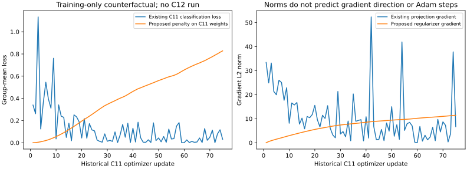

# Phase 10C.12 — Pretrained projection preservation preflight

Implemented an optional, disabled-by-default L2-SP term on exactly the original OWLv2 classification projection. One fixed, training-only-derived strength is proposed: **lambda = 78.92715855598048** for a **half-squared sum**, not a mean. CPU verification passed. **No GPU training, inference, downloads or new model checkpoint occurred.**

## Verified historical model and architecture

Parent commit: `63ad5c3ca0ac51bf24e72575a39927d8222b6d9c`; branch: `experiment/phase10c12-projection-preservation`. Actual installed `Owlv2ClassPredictionHead` source and the local model tensors were inspected rather than inferred from names. Its `dense0` maps 768-dimensional image features to 512-dimensional class embeddings; normalized image/text similarity is followed by `(similarity + logit_shift(image_features)) * (ELU(logit_scale(image_features)) + 1)`.

| Regularized parameter | Shape | Scalars | Original L2 | C11 displacement L2 | Relative displacement |
|---|---|---:|---:|---:|---:|
| `class_head.dense0.weight` | 512 × 768 | 393,216 | 9.70110005 | 0.145737743 | 1.50228% |
| `class_head.dense0.bias` | 512 | 512 | 0.100537719 | 0.006170258 | 6.13726% |

The original checkpoint SHA-256 remains `e1e130b9e404cf91a75ad45644c1da9d7fa5284085eecc864266a6923efb99e7`. C11's saved checkpoint remains `44690ee1b148e1815d97cd25ba9aa693c8d7a582a2b13ac30d3c0676d74e365f`. The four calibration tensors (`class_head.logit_shift.{weight,bias}`, `class_head.logit_scale.{weight,bias}`) were verified unchanged in all **76** C11 snapshots. Original and trained tensor fingerprints are in `parameter-audit.json`.

C11 had exactly one AdamW group containing the two projection tensors and six box-head tensors: 1,577,988 trainable scalars. All 75 optimizer-state cursors and source-order lists were checked, including equality with C8 corrected Arm B ordering. LR 1e-5, betas (0.9, 0.999), epsilon 1e-8 and weight decay 0.01 remain fixed. The backbone, normalization, text encoder, objectness head and calibration remain frozen. Detector calibration is not the unrelated `owlv2.logit_scale` parameter.

Existing endpoint-validated cached-feature evidence from C11 attributes its remaining mean +3.01103 seven-category logit shift (+4.24799 for Chair) to the changed projection, with zero changed-shift/scale contributions. This verifies the previous phase's diagnosis; those development-derived outputs were **not used to select lambda**. No attribution or inference was rerun here.

The historical functional attribution treats projection weight and bias jointly. Both tensors changed; their separate functional contributions were not measured, and no individual causal percentage is claimed.

## Objective and safeguards

For the two tensors above only:

```text
L_SP = 0.5 * (sum((W - W_original)^2) + sum((b - b_original)^2))
L_total = L_C11_existing + lambda * L_SP
gradient_SP(theta) = lambda * (theta - theta_original)
```

`preservation12.py` clones the pinned original FP32 references, detaches them and keeps them outside the model/optimizer. Reference hashes are checked before use, device-cache mutations are rejected, public configuration properties are read-only, and checkpoint metadata binds the original reference hashes. Reference tensors never become trainable or receive gradients. No original weights are edited or replaced.

`objective12.py` calls the unchanged C11 observation/C8 corrected loss. Positive annotations, Hungarian matching, source-supported Chair negatives, ignored regions, focal coefficients and box loss remain untouched. There is no new category, generic background target or conversion of uncertain regions into negatives. With preservation disabled, the original loss, parts, statistics and input gradients are returned unchanged; no zero-valued tensor is added to the baseline loss.

When enabled, the parameter-only term is added to each microbatch loss before the existing accumulation division. Four-microbatch groups and the final three-microbatch group therefore contribute **one** penalty per optimizer update. It is not divided by the positive-box count, seven categories or number of projection parameters. This convention must remain fixed: using MSE with the same numeric lambda would weaken the intended term by a large factor.

Subtraction and squared summation run in FP32 outside autocast; audit norms use FP64 over saved FP32 parameters. No half-precision reference storage or penalty accumulation is used. FP16 image forwards, FP32 base loss/weights, scaler initialization/growth and gradient clipping remain C11's settings. Existing AdamW decay toward zero is retained; L2-SP adds a separate anchor toward the pretrained values.

The regularizer directly affects only the projection gradients. Box-loss derivatives are unchanged for identical model outputs. Subsequent box updates can still differ through the unchanged global gradient clipping and through changed discrete matching as model predictions diverge; this is a coupled optimization consequence, not an additional box objective.

## One training-only lambda proposal

The selection rule was stated before calculating the value: at C11's final projection drift, make preservation cost equal to the classification-loss reduction measured on the **same fixed optimization-training photographs** before and after C11 training. A unit energy-balance ratio is an explicit diagnostic design choice, not a data-proven optimum.

| Training-only evidence | Value |
|---|---:|
| Fixed optimization probe photographs / known source groups | 24 / 24 |
| Mean corrected classification loss before training | 0.869236013542 |
| Mean corrected classification loss after epoch 5 | 0.029547265187 |
| Mean classification-loss reduction | **0.839688748355** |
| Unweighted C11 endpoint L_SP | **0.010638780918** |
| Proposed lambda = reduction / endpoint L_SP | **78.92715855598048** |
| Weighted penalty at the historical endpoint | **0.839688748355** |
| Regularizer gradient norm at that endpoint | **11.51297068** |

Selection used 48 existing training-probe JSON records, C11 parameter snapshots and training optimizer diagnostics. Every probe identity was checked against the exact optimization partition and source hashes. No development logits, feature caches, precision, recall or AP entered the strength calculation. There was no hyperparameter search or list of alternative strengths.

For scale, C11's final-epoch mean existing classification loss over all 59 training photographs was 0.04273912 and mean weighted box loss 0.42349720. At the historical final drift, the proposed penalty is about **28.4 times** the residual 24-probe classification loss, or **19.6 times** the final-epoch 59-photo mean classification loss. It is deliberately substantial rather than a nearly inactive prior.

Along the saved last-epoch C11 trajectory, the counterfactual regularizer/data projection-gradient norm ratio has median **2.41583**, range **0.30017–31.23621**. Existing last-epoch projection pre-clip gradient norms have median 4.50903. These comparisons use the contemporaneous pre-update parameter state at each saved update. Gradient directions were not retained, so norms do not establish cancellation or predict AdamW steps. Global clipping and adaptive moments further limit such predictions.

This strength can dominate late classification gradients and sacrifice recall. The 24 probes are biased toward photographs containing source-supported negative evidence and are not a representative sample of all furniture scenes. Box-head movement affects matching and coverage, so the classification improvement is not a projection-only causal gain. The new trajectory and resulting penalty are unmeasured; no claim is made that it will reach the historical endpoint or improve detection. The rule is a reproducible diagnostic strength proposal, not an optimal setting.



The figure evaluates the single proposed penalty on **historical C11 states**. It is not a new training curve or a prediction of C12 behavior.

## Disabled experiment and future execution

Exactly one proposal is provided in `experiment-disabled.json`, with training, source-supervision activation and projection regularization all disabled. `launch12.py` rejects it before spawning a worker or creating the experiment directory. C11's old authorization cannot activate C12. A future activation requires separate explicit user authorization, a new configuration/approval record bound to file and semantic hashes, the complete pinned implementation set and the exact proposed lambda/reference hashes.

| Setting | One proposed arm |
|---|---|
| Initialization | Immutable original full pretrained OWLv2 |
| Difference from historical C11 | Additional projection L2-SP term only |
| Optimization data | Same 59 photographs / 56 known source groups / 182 positive boxes |
| Corrected negative evidence | Same 41 source-supported regions; unknowns remain ignored |
| Internal diagnostics | Same 19 training-derived development photos; no reserved/frozen scoring |
| LR / optimizer / seed | 1e-5 / unchanged AdamW / 6106 |
| Batch / accumulation | 1 / 4, final group normalized by 3 |
| Maximum epochs / updates | 5 / 75 total |
| Maximum GPU queue runtime | 600 seconds, including evaluation inference |
| VRAM stop boundary | 6.5 GiB |
| Maximum forwards | 467, same C11 training/probe/evaluation schedule |
| Output destination | `data/open-images/experiments/phase10c12-projection-preservation-v1/` |
| Output storage guard | 4 GiB; approximately 1.6–2 GiB expected |
| Primary endpoint | Epoch 5, fixed before execution; no adaptive epoch/threshold selection |

Runtime estimate is roughly 4–6 minutes based on C11's 213.65-second queue; actual C12 runtime is unmeasured. C11's 1.89-GiB peak allocated / 3.36-GiB sampled device usage provides a reference, not a C12 memory measurement. Reference copies, penalty and gradient diagnostics add a small number of projection-sized tensors; the hard limit remains authoritative.

The future worker is an isolated, tested derivation of C11. It records existing classification/box/Chair-positive/Chair-negative losses, separate unweighted/weighted preservation losses, total pre-clip norms, analytic regularizer gradients and data-gradient norms after subtraction. Calibration/reference hash checks, finite checks, time/memory guards and unique per-update snapshots remain in place. Initial probe/reference predictions must agree with C11's original initialization before the first update.

Snapshots retain all 12 heads for inference compatibility and the exact eight-key optimizer state, plus lambda, enable flag, original-reference hashes, configuration binding, scaler, RNG and epoch/group cursor. Tested restore helpers reject changed lambda/references/configuration or inconsistent cursors before copying weights, and recover the same next synthetic optimizer update. The launcher is intentionally **fresh-run-only**: no automatic replay after an uncertain update. An interrupted future execution would require an explicit recovery entry point respecting remaining cumulative time/update budgets; this phase does not claim that automatic GPU resume was exercised.

## Future evaluation contract

`evaluate12.py` is prepared but not executed. It refuses to calculate new metrics without a completed, separately authorized C12 run. It verifies the exact 19 internal-photo identities, hashes, FP32 inference and raw completeness; saves per-image postprocessed predictions atomically **before** CPU metric calculation; and uses the unchanged partial-label metric implementation.

Compare original, historical C11 and the one new endpoint with identical category order/prompts, processor, NMS 0.5/cap 300, confidence 0.15, AP floor 0.001, IoU 0.5/0.75 and supported-class AP conventions. Record total/per-category TP/FP/FN, Chair counts at 0.15/0.50/0.80, raw aligned-query score distributions, shared seven-category logit drift, parameter drift, precision at original and C11 matched recall, Sofa/Bed regressions and all loss/gradient components. Unsupported native categories receive no invented AP; unknown unmatched predictions remain separate from scored FPs. No frozen independent material is used.

A favorable diagnostic would reduce common logit inflation and improve precision at matched recall while preserving C11 Chair/Sofa/Bed recall. Tradeoffs or unattainable matched recall must be reported. This is a comparison criterion, not permission to tune lambda, thresholds or loss weights after seeing results. No result on the exposed internal panel establishes the independent 80%-precision/90%-recall acceptance objective.

## Independent evaluation readiness

The existing C9 protocol proposes **140 unseen real-room/source groups**, at least **50 fully annotated instances per category**, complete seven-class whole-object annotations, independent QA/adjudication, photo-specific rights, exact/near-duplicate and source/session isolation, a predeclared operating point and source-group confidence intervals. It remains proposal-only; no source manifest establishing this acceptance pool was found in the audited readiness artifacts.

- The current combined readiness metadata contains 156 source rows, **zero** with independently verified full seven-class completeness.
- Historical frozen membership remains 60: 18 provisional candidates, 23 unresolved screening, three scene-quarantined and 16 licensing-quarantined/not acquired. None has a human-reviewed or verified-scene flag in the inspected screening metadata.
- Known metadata intersections with the current training/development IDs, hashes and groups are zero; 16 nonacquired photographs lack source hashes. These checks do **not** establish complete annotation, room/session independence or current perceptual screening.
- **Zero photographs are established as a qualified, complete seven-class independent acceptance pool by this audit.** This does not mean no independent photographs exist elsewhere; qualification has not been demonstrated.
- Chair must include seating/bar stools; footstools/ottomans/step stools remain separate. Cabinet-front/whole-unit, Desk/Table and standalone Lamp/fixture semantics require explicit consistent policies. Uncertain objects remain ignored, not confirmed negatives.

No evaluation photographs were decoded, visually reviewed, reannotated, reassigned or used to construct training masks. Historical preservation checks read file bytes for hashing; they do not score or visually inspect images. The exposed 19-photo panel, historical 18/36-photo panels and training photographs cannot be repurposed as new independent evaluation data.

## Verification, preservation and next approval

**144 CPU tests passed**: 31 current C12 tests, 13 C11 tests, 21 frozen-scope/checkpoint tests, 16 C8 loss tests, 31 C6 mask/evidence tests and 32 expanded-data/base tests. They cover reference immutability/corruption, zero/drift penalties and restoring gradients, exact parameter scope, FP32/FP16 loss/mask/box-gradient compatibility, 3/4-microbatch normalization, optimizer exclusion, mode transitions, changed checkpoint configuration rejection, serialization/next-step recovery, default-off launch behavior, complete code binding and standalone no-CUDA imports. Synthetic optimizer arithmetic is isolated test data, not model training.

C11's 31 public and 626 private sealed files remained unchanged. Broader preservation passed for 9,973 historical data/model files, 160 Phase 10B snapshots, 24 report artifacts, 27 historical implementation files and all 78 eligible source-image hashes. Original OWLv2, historical adapted heads, SigLIP 2 artifacts, source annotations/partitions and the Mac application remain untouched. No packages or environment settings were changed. No GPU execution directory or new model checkpoint was created.

Code and small reports are committed and pushed on the new experimental branch. Private data, photographs, activations, checkpoints and test logs remain local. `main` remains `e14c4c253d4680e7d3c2a87d0d896c6d20e86aa6`.

**Exact next authorization needed:** one frozen-calibration C12 arm with the half-squared-sum projection penalty at lambda **78.92715855598048**, the fixed configuration above, maximum five epochs/75 updates/600 seconds/6.5 GiB, the same 59 optimization and 19 internal-development photographs, fresh isolated outputs and no additional variants, downloads, independent/frozen scoring, deployment or Phase 10D. The disabled configuration is ready for review. Nothing will run until that separate authorization is provided.
