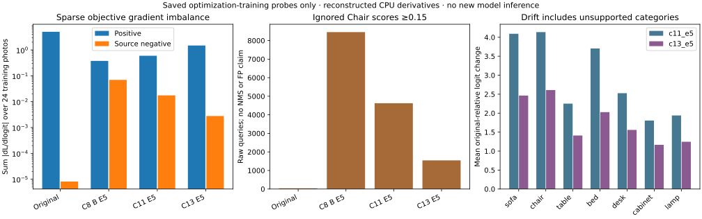

# Phase 10C.14 — Training-query attribution and hard-negative audit

The evidence supports a sparse-supervision and effective-gradient imbalance, compounded by limited negative coverage. It does **not** establish that another regularization setting will solve the problem. The implemented tools replay saved training outputs on CPU, expose individual assignments and evidence, and propose one controlled loss intervention behind a new approval gate. No model inference, GPU work, training, downloads, new human decisions or production changes occurred.

The 80% precision / 90% recall objective remains an unestablished independent seven-category target.

## Historical verification

Parent commit: `3676f652aa39fa0ab6ca83f1a1a5be12e33a94ef`. Branch: `experiment/phase10c14-training-query-audit`.

The actual C8 corrected, C11 and C13 final checkpoints contain 75 committed optimizer updates. C11/C13 calibration tensors equal the original tensors. C13 joint projection displacement is 0.02264240 versus C11's 0.14586830: **84.4775% less**. Hashes and exact checkpoint paths are in `historical-verification.json`.

Original base SHA-256: `e1e130b9e404cf91a75ad45644c1da9d7fa5284085eecc864266a6923efb99e7`.

These numbers are copied from verified historical results, not newly scored. The exposed 19-image panel is diagnostic only. Its errors, images and labels were not inputs to negative mining or objective calibration.

| Historical endpoint | Precision @0.15 | Recall | AP50 | AP75 | TP / scored FP / FN |
|---|---:|---:|---:|---:|---:|
| Original | 62.69% | 68.85% | 74.99% | 55.28% | 42 / 25 / 19 |
| C8 corrected B | 6.86% | 95.08% | 75.25% | 55.21% | 58 / 788 / 3 |
| C11 frozen calibration | 8.76% | 90.16% | 76.76% | 60.58% | 55 / 573 / 6 |
| C13 projection preservation | 14.45% | 81.97% | 75.27% | 52.95% | 50 / 296 / 11 |

C13 reduced scored FP, but recall and AP75 regressed. At the original reference recall, saved PR-envelope precision was 56.00% for C13 versus 56.76% for C11. Thus the fixed-threshold FP reduction is not a matched-recall improvement. Incomplete labels mean unmatched predictions are not automatically scored FP. The native Chair-versus-Stool limitations of those results remain unchanged.

## Evidence scope and reproducible replay

The canonical optimization pool contains **59 photographs, 56 known source groups and 182 active boxes**: Chair 114, Sofa 40, Bed 28. Table, Desk, Cabinet and Lamp have no active positive boxes or explicit native negative targets. Native whole-photo negatives in this pool exist for Sofa on two photos and Bed on one; none establishes general Chair absence. Source groups are known provenance groups, not proof of independent physical rooms.

Saved full query arrays exist for only **24 optimization photographs**, covering 24 groups and 79 active objects: Chair 50, Sofa 24, Bed five. Thirteen states cover original epoch zero and C8 control/corrected, C11 and C13 epochs 1/3/5. This gives **312 cached photo-states and 1,123,200 query-state records**, each with seven logits and an original-frame box. Actual update logs cover all 59 photos, five presentations each, separately from these probes.

The audit replays the executed C8 objective on saved FP16-forward arrays cast to FP32. All 312 saved loss, mask-count and source-region-count checks pass at absolute tolerance 1e-5 / relative tolerance 1e-4 for floating losses; counts match exactly. Hungarian indices were not saved, so the dashboard labels them **CPU reconstructed**. Agreement does not prove bit-identical GPU tie breaking. Source hashes, original dimensions and exact square-padding transforms are preserved.

For one original 24-photo state, the 604,800 binary class-query terms comprise:

| Category | Positive | Negative | Ignored |
|---|---:|---:|---:|
| Sofa | 24 | 0 | 86,376 |
| Chair | 50 | 292 | 86,058 |
| Table | 0 | 0 | 86,400 |
| Bed | 5 | 0 | 86,395 |
| Desk | 0 | 0 | 86,400 |
| Cabinet | 0 | 0 | 86,400 |
| Lamp | 0 | 0 | 86,400 |

**604,429 terms (99.9387%) remain ignored.** That protects incomplete annotations; it is not permission to turn those terms into background. Control-arm source-negative losses and masks are counterfactual only and never enter its objective.

## Measured objective mechanism

Hungarian matching uses the unchanged class cost plus 5×L1 and 2×GIoU cost, one matched query per active positive annotation. Focal alpha is 0.25 for positives / 0.75 for negatives, gamma two. Every active classification term is divided by the same per-image positive-box count. There is no asymmetric divisor, explicit recall reward, confidence-threshold change or discovered accidental all-background conversion.

With `p = sigmoid(z)`, a source-supported negative contributes `0.75 × p² × softplus(z) / nGT`. Its derivative shrinks approximately as p³ for an easy negative. Positive terms retain much stronger pressure when positive scores are low. The following sums are in **output-logit gradient space**, not shared head-parameter space:

| Cached endpoint, 24 photos | Positive gradient L1 | Applied source-negative gradient L1 | Ignored Chair queries ≥0.15 |
|---|---:|---:|---:|
| Original, corrected mask diagnostic | 5.05568 | 0.000008133 | 38 |
| C8 B E5 | 0.37773 | 0.06962 | 8,455 |
| C11 E5 | 0.59520 | 0.01751 | 4,625 |
| C13 E5 | 1.48405 | 0.002788 | 1,545 |

At initialization the positive/source-negative output-gradient mass ratio is approximately **621,617:1**. A conditional uniform positive offset of all seven logits would lower the classification objective on 24/24 original photos, 23/24 C8 B E5 photos, and 24/24 C11/C13 E5 photos. This is a local derivative with fixed reconstructed assignments/masks, not proof that an arbitrary constant offset is an independently trainable parameter.

Recorded GPU projection-gradient norms independently show a weak effective negative signal: the median source-negative/data projection norm ratio at C11 E5 is **0.001004**, and at C13 E5 **0.000004168**. Original probes record zero additional projection-gradient norm on 13/24 photos, although only five lack source-query coverage. CPU output derivatives can be tiny but nonzero. Saved intermediates cannot identify exactly which AMP/cancellation operation caused a recorded zero; focal attenuation is measured, a particular underflow path is not proven.

Approximate aggregate signed projection gradients can be recovered from consecutive Adam first moments and recorded clipping factors. C11/C13 recovered norms agree with logged norms to maximum relative errors **3.41e-6 / 4.69e-7**. C13's analytic L2-SP contribution is removed for this diagnostic. This recovers an optimizer-group aggregate, not per-image or positive-versus-negative parameter vectors. C8 lacks optimizer parameter-name bindings, so no guessed mapping is used. See `aggregate-gradient-recovery.json`.

All seven logits increase at **100% of aligned cached training queries** at final C8 B, C11 and C13 endpoints. C11 mean original-relative increases are Sofa +4.09, Chair +4.14, Table +2.25, Bed +3.71, Desk +2.53, Cabinet +1.81, Lamp +1.94. C13 attenuates, but retains, the increases. The four unsupported classes have zero direct classification derivatives. Broad cross-category coupling through the shared adapted classification projection is therefore observed even with frozen backbone and calibration. Exact per-positive contribution paths require missing pre-head activations; the saved outputs do not identify a unique causal parameter decomposition.



## Matching, localization, duplication and scale

Positive assignment indices change for 16/79 objects in C8 B and C11 E5, and 14/79 in C13 E5. A dense patch index is not a persistent detected-object identity. Nevertheless, this replay finds no mask or matching implementation discrepancy against saved records.

Two of 50 Chair matches have IoU below 0.5 in original and final C8 B/C11/C13 states; neither Sofa nor Bed has a below-0.5 match in this cached cohort. This does not validate every source box. Matched Chair median IoU stays near 0.85. All reconstructed **unmatched box-output gradients are zero**; matched box derivatives remain active and finite. GIoU and standard IoU are reported separately. See `positive-matching-quality.json`.

High-score ignored queries include repeated or fragmented known furniture. C11 E5 has 186 overlapping known Chairs at IoU≥0.5, 489 meeting a contained-fragment heuristic and 105 overlapping other active furniture at IoU≥0.5. These sets can overlap. They are raw queries, not NMS detections or automatically incorrect labels. Padding anchors and predicted boxes extending beyond the original frame are recorded separately; C11 has 105 / 492 respectively among high-score ignored Chair queries.

The source-negative scale coverage is narrow. Originally, **273/292** negative queries occupy under 1% of the image and 19 occupy 1–5%; none exceeds 5%. C11 E5 retains 262 under 1% and 19 at 1–5%. Its high-score ignored Chair queries span 2,012 under 1%, 1,595 at 1–5%, 780 at 5–20%, and 238 at ≥20%. Adding center-only or overlapping-box negatives would change evidence semantics and is not done.

## Existing negatives are mostly easy

The C7 reference is reproduced: **292 original source-negative queries, 19 photos/groups with coverage, 24/41 regions covered, 17 uncovered**. Final C8 B/C11/C13 have 285/281/288 queries respectively; each still covers 24 regions on 19 photos/groups. Zero-coverage region IDs and per-photo query IDs are in the private `negative-coverage.json` and dashboard.

Actual per-update training logs, not probe estimates:

| Completed corrected run | Source-negative term occurrences | Score ≥0.15 | Score ≥0.50 | Median score | Maximum score |
|---|---:|---:|---:|---:|---:|
| C8 B | 1,429 | 7 | 0 | 0.002632 | 0.307670 |
| C11 | 1,433 | 3 | 0 | 0.001427 | 0.206574 |
| C13 | 1,443 | 0 | 0 | 0.000726 | 0.123260 |

Term occurrences repeat regions/queries across presentations; they are not independent examples. Some negative scores increase, but most remain easy. Thousands of high-score ignored queries lie outside trustworthy source coverage. The historical workers record zero protected-target violations. Ignored real Chairs, seating stools, fragments and mixed crops remain protected from invented negatives.

## Hard-negative evidence search and visual findings

Only the exact optimization pool was searched. Its 1,005 native annotation records include COCO/LVIS overlays and must not be counted as independent objects. A candidate query had to be Chair≥0.15, ignored, unmatched to any positive, within the original frame, at least 32 pixels per side, outside all known furniture/protected/uncertain boxes, and wholly certified inside a simple visible native non-Chair polygon with the existing safety margin. Native bounding-box overlap alone is not absence evidence.

The search yields **nine source-lineage proposals, seven distinct rectangles, four photographs/groups**. All overlap existing approved negative rectangles on the same person, handbag or television assets. Four private contact sheets were actually inspected. Eight lineage records / six rectangles are visually source-corroborated; one dark reflective-screen case remains uncertain. **Zero newly additive training-eligible hard negatives; zero targets activated; zero human decisions created.** Replacing or uniting existing rectangles would require a new versioned policy and validation, not double-counting an overlapping proposal.

Eleven targeted context examples are also recorded. High-score queries inside person or curtain bounding boxes sometimes visibly depict actual seating or mixed furniture. One pink Chair/seating-stool query scores about 0.964 and is explicitly **not a negative**. Tree ornaments, screen edges and drawer-like parts are possible confusions, but their whole query crops are not independently certified as Chair-free. Assistant visual notes are identified as such and never recorded as human review. See `visual-findings.json`; full polygon/source hashes and score observations remain private under the diagnostic directory.

## Alternative objectives and teacher feasibility

| Approach | Evidence and dependency | Principal risk / conclusion |
|---|---|---|
| A. Verified hard negatives | Current trusted regions have actual model coverage, but proposed geometry adds no new independent eligible region. | Scarce scale/content coverage; expanding via unmatched predictions would introduce false negatives. Useful future data work, not sufficient by itself. |
| B. Positive/negative gradient balance | Easy source negatives are strongly focal-attenuated; recorded projection contributions are often tiny. | Removing only their modulation is a minimal testable change; it can still be ineffective or dominate and hurt recall. Recommended next intervention, after a gradient smoke gate. |
| C. Original teacher preservation | Original logits/boxes exist for 24/59 optimization photos, all seven categories. Same source/frame/prompts and frozen 60×60 backbone lattice permit conditional dense-patch correspondence. | Teacher mistakes, missing 35 photos, changing predicted boxes/matches and incomplete labels prevent unrestricted seven-class distillation. |
| D. Selective classification adaptation | Projection preservation reduced drift but lost recall; calibration freezing alone was inadequate. | No saved pre-head training features to identify a safe discriminative subspace. Further restrictions may repeat underfitting rather than solve evidence coverage. |
| E. Matching/query-selection revision | Reconstructed matching agrees with saved losses; some low-IoU positives and query changes are documented. | No confirmed implementation defect justifies changing matching now. IoU gates could drop difficult true positives. |
| F. Localization-focused adaptation | Box-only analysis is technically separable. | Cannot test the observed classification-gradient imbalance; classification or recall may remain poor. Phase 10D remains unauthorized. |

The teacher can reuse its cached outputs without duplicate teacher inference each update **for 24 photos only**, assuming identical deterministic source bytes, orientation, preprocessing, precision, prompts, patch lattice and no new augmentations. It must not be treated as an oracle or matched by presumed object identities. Safe Chair-negative patch intersections between original and final C8 B/C11/C13 are 282/280/284, with no teacher Chair score≥0.15 on those intersections. They establish a narrow eligible comparison, not seven-category absence.

Known positive Chairs/seating stools and teacher disagreements override or exclude a distillation target; uncertain or unverified pixels remain ignored. Other category outputs could be inspected but do not become seven-class negative labels. Original training pre-head/image/text features, objectness, 35 photos' teacher outputs, and full per-update query arrays were not saved. CPU algebra cannot uniquely recover them. The 19 development activation files are excluded from training. A masked teacher pilot on the cached 24 is feasible; a complete unmasked seven-class objective is **not ready**. No distillation trainer was implemented.

## One next intervention, explicitly unapproved

Recommend testing **removal of gamma-two focal modulation only for the existing source-supported Chair-negative terms**:

```text
existing: 0.75 × sigmoid(z)^2 × softplus(z) / nGT
proposed: 0.75 × softplus(z) / nGT
```

Positive and native-negative focal terms, all masks, Hungarian matching, 5×L1/2×GIoU, ignore policy, alpha, denominator, thresholds and data stay unchanged. No new labels, generic background, count normalization, L2-SP or intervention combination. This is a proposal and CPU output-gradient counterfactual, not a change to any trainer or production default. At C11 E5 the counterfactual source-negative output-gradient L1 is 1.13250 versus focal's 0.01751. This does **not** establish the AMP projection-gradient effect or a performance gain.

The immediate approval request is a **zero-update GPU gradient smoke**, maximum 24 forwards / 180 seconds / 6.5 GiB allocated VRAM / 128 MiB new output. Use only the exact C6 24 optimization photos, original immutable base plus the saved C11 final head, and both loss formulas on identical outputs. No optimizer, weight updates, automatic retry, development scoring or follow-on training. Record separate positive/native/source projection gradients, finite checks, masks and source attribution; stop on any integrity or masking failure. Proposed destination, exact fingerprints, parameter names and limits are in `next-experiment-proposal.json`; the destination was not created.

For any later separately approved training, retain C11's exact eight trainable tensors: `class_head.dense0.weight/bias`, `box_head.dense0.weight/bias`, `box_head.dense1.weight/bias`, `box_head.dense2.weight/bias` (1,577,988 scalars). Freeze the four logit-shift/scale tensors and every other parameter. Use original initialization, identical 59-photo order/seed 6106, LR 1e-5, at most five epochs / 75 updates / 600 GPU seconds / 6.5 GiB. C11 is the clean historical comparator; C13 is not because it adds L2-SP. No coefficient or threshold search.

Success would support further investigation only if unchanged-protocol matched-recall precision improves without Sofa/Bed recall or localization regression. The 19-image panel remains an exposed diagnostic, never independent acceptance. The final 80%/90% target requires a future separately approved, identity-isolated, completely annotated real-room set covering all seven categories, fixed before inference, with uncertainty intervals and category-level reporting. No such material is accessed here. A successful smoke does not authorize training.

## Dashboard, tests and preservation

**Live dashboard: http://localhost:8774/**. It displays only the 59 optimization photos: 24 have query snapshots, 35 explicitly have no cache. Use the photo/checkpoint/category menus, positive/negative/ignored filter, viewer-only score control and zoom; click a query for original pixel coordinates, all seven scores, gradients and source-region evidence. The two panes compare the original to the selected historical checkpoint. Native boxes are context, source-supported negatives are separate overlays, and masks/gradients are labelled reconstructed versus recorded. No annotation task is mandatory, and there are no training, inference or review-writing endpoints.

Restart if needed:

```bash
cd /home/tristary/furniture-ai-ml
CUDA_VISIBLE_DEVICES='' .venv/bin/python -B tools/phase10c14-v1/server14.py --port 8774
```

**147 CPU tests passed**, including C14 replay/isolation/HTTP safety, C13/C11 compatibility, frozen optimizer scope, C8 loss, C6 masks and expanded-data tests. Installed Windows Chrome ran with GPU disabled: **25 interaction checks passed**, plus a real 59-photo dashboard render with both panes and a private screenshot. Browser checks include seven scores, masks, coordinates, zoom, uncached-photo stale-state clearing, no inference fallback and denied write/reserved routes.

Read-only preservation passed for 9,973 historical data/model files, 160 Phase 10B snapshots, 24 historical report artifacts, 27 historical implementation files and 78 eligible source-photo hashes. C8/C11/C13 seals and final checkpoints also pass. Source-group isolation, original annotations and frozen partitions remain unchanged; no reserved/frozen photograph was decoded. These hash checks verify local preservation, not the existence of an external dataset/model backup.

Private caches, source photographs, contact sheets, browser captures and logs remain under `data/open-images/diagnostics/phase10c14-v1/` and outside Git. Only code and small reports are committed. Machine-readable results, disabled proposal, provenance and integrity seals accompany this report.
