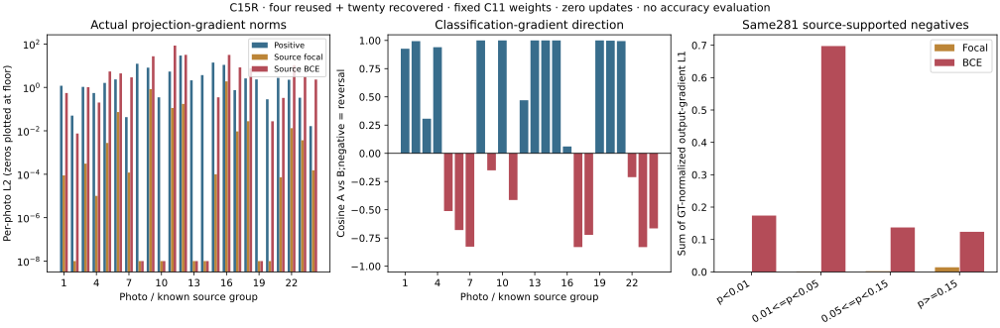

# Phase 10C.15R — Completed focal versus BCE gradient recovery

**Recovery complete. Diagnostic decision B: excessive and uneven suppressive-gradient risk at the unchanged coefficients.** BCE supplies a real, finite negative signal and restores two covered groups whose measured focal projection gradient was zero. However, it dominates positive projection gradients in many source groups and reverses the total classification direction. This is a gradient diagnostic, not evidence that Chair recall actually regressed or that BCE is universally unsuitable. No training, optimizer steps, inference on evaluation material, new loss variants or downloads occurred.

## Authorized execution and identical model state

Continued from commit `f77d77403a65391f88369d9e17925d6127d68666` on `experiment/phase10c15-negative-gradient-smoke`. Exactly one fresh recovery process used the existing project `.venv/bin/python` and RTX 4070 Laptop GPU. Historical outputs remained immutable.

- Four completed C15 receipts and raw query/gradient files were verified and reused. Their photographs were not forwarded again.
- Photographs **5–24 only** received **20 new forwards**, including the explicitly authorized repeat of photo five. The failed first attempt consumed five forwards, making **25 cumulative forwards** for 24 unique photographs.
- Each newly completed photograph used one model forward graph and seven isolated `autograd.grad` calls: positive, native-negative, source focal, source BCE, classification A, classification B and shared box loss. **140 new / 168 cumulative gradient calculations**.
- No optimizer was constructed. All model `.grad` fields remained `None`; no parameters were updated. Gradient-enabled tensors were the same two classification-projection and six box-head tensors as C11. Calibration shift/scale and every other tensor stayed frozen.
- Original OWLv2 initialization plus the saved C11 final head matched the first attempt exactly. All 20 recovered logits and boxes were bit-identical to their historical C11 FP16 probe outputs. Full parameter and buffer fingerprints, including nonpersistent buffers, were verified after every recovered photograph and again at completion.

Live model fingerprint before and after recovery:

`1f597e28003a9ccb62c2b6c43bca8a33e03d86187740a802aa0fd4725b319e61`

Immutable original OWLv2 file SHA-256:

`e1e130b9e404cf91a75ad45644c1da9d7fa5284085eecc864266a6923efb99e7`

Immutable C11 head SHA-256:

`44690ee1b148e1815d97cd25ba9aa693c8d7a582a2b13ac30d3c0676d74e365f`

## CPU gate and loss control

Before GPU execution, **25 CPU tests passed**, including exact historical box-loss equality on all 24 cached photographs. The repaired `tools/phase10c15-v1/loss15.py` was imported unchanged: normalize L1 by active GT count first, then multiply by five. There was no relaxed GPU equality check. The recovery also verifies original source hashes, category order, corrected supervision evidence, protected regions, matching and the exact 5–24 whitelist.

Both variants use the same pre-sigmoid OWLv2 logits, positive annotations, Hungarian assignment and trusted-negative masks. The original positive/native focal loss, 5×L1 + 2×GIoU box loss, alpha coefficients and per-image active-GT divisor remain fixed. FP16 forwards and the historical scale-128 gradient calculation use FP32 loss arithmetic.

```text
A: existing source Chair negative = 0.75 × sigmoid(z)^2 × softplus(z) / nGT
B: trusted source Chair negative = 0.75 × BCEWithLogits(z, target=0) / nGT
```

BCE is applied only to additional source-supported Chair-negative terms. Unknown, incomplete, protected and unmatched unevidenced queries remain ignored. No generic background labels, new regions, weight tuning, teacher loss or additional variants were introduced.

## Combined supervision and coverage

The 24 photographs represent 24 known source groups, not independently verified physical-room identities. The combined cached cohort has:

| Quantity | Count |
|---|---:|
| Positive terms | 79: Chair 50, Sofa 24, Bed 5 |
| Trusted Chair-negative terms | 281 |
| Ignored class-query terms | 604,440 of 604,800 |
| Protected/positive target violations | 0 |
| Source groups with covered negative queries | 19 |
| Source groups without covered negative queries | 5 |
| Covered source regions | 24 of 41 |
| Uncovered source regions | 17 |

Coverage is unchanged by BCE. It strengthens existing terms and does not make any unknown region eligible. Table, Desk, Cabinet and Lamp receive no new direct supervision.

## Output derivatives versus actual projection gradients

The positive loss is identical for A/B. There are no native-negative terms in this 24-photo cohort. Output-gradient mass and parameter-gradient norms refer to different spaces and must not be compared as interchangeable quantities.

| Combined 24-photo statistic | Focal A | Trusted-negative BCE B |
|---|---:|---:|
| Mean positive loss, shared | 0.0292600 | 0.0292600 |
| Mean trusted-negative loss | 0.000287254 | 0.0483606 |
| Mean total classification loss | 0.0295473 | 0.0776206 |
| Negative output-gradient L1, summed | 0.0175086 | 1.13250 |
| Positive output-gradient L1, shared | 0.595197 | 0.595197 |
| Positive / negative output-gradient ratio | 33.9946 | 0.525558 |
| Mean per-photo negative projection-gradient L2 | 0.131184 | 9.24055 |
| Mean per-photo total classification projection-gradient L2 | 4.28803 | 10.12472 |
| Maximum individual negative output-gradient magnitude | 0.0109802 | 0.0823770 |
| Groups with nonzero negative projection gradient | 17 | 19 |

Thus BCE raises negative output mass **64.68×** and the mean negative projection norm **70.44×**. Mean positive projection norm is 4.34415. There were no nonfinite gradients or supervision violations. Source-negative gradients remained separate from box regression, and frozen calibration tensors received no accumulated gradients.

Aggregation is consistent: output L1 sums per-photo GT-normalized derivative magnitudes; parameter norms are the arithmetic mean of each photo's norm. **The mean of norms is not the norm of an average signed gradient.** The first four photos' full parameter-gradient vectors were not saved, so no full-24 signed aggregate vector or cosine is invented.

The separately labelled **20-photo recovery-only** mean gradient vectors are available: positive projection norm 4.36146, focal-negative 0.152547 and BCE-negative 10.74167. For those 20 only, the mean classification A/B cosine is **-0.38419**; positive versus BCE-negative cosine is **-0.71609**. This is not presented as a full-24 aggregate.

## Source-group variability and suppression risk

All 19 covered groups have a negative cosine between positive and BCE-negative projection gradients. Opposing positive pressure is the purpose of negative supervision, so opposition alone is not a failure. The concern is its highly variable magnitude and effect on the total direction:

- BCE-negative projection norm exceeds positive projection norm in **12/19 covered groups**; four exceed it by more than 10×.
- The covered-group ratio ranges **0.0251–139.43**, median **2.8667**. A small positive denominator can inflate a ratio after C11 training, so ratios are accompanied by absolute norms in the source-group report.
- Total classification A/B directions have negative cosine in **10/24 groups**. The most negative per-photo cosine is -0.83067. The change is not merely a uniform rescaling of the original classification gradient.
- Three groups account for **66.47% of the sum of per-photo BCE projection norms**. That is a descriptive concentration statistic, not an additive decomposition of a signed cohort gradient. Their source term counts are 33, 14 and 27; their BCE projection norms are 84.50, 31.60 and 31.31.
- Across the new 20-photo mean vectors, focal and BCE negative directions remain similar (cosine **0.97324**), while BCE changes their strength enough to reverse the combined direction relative to A.

These measurements support decision **B at the existing normalization/coefficient**, interpreted as potentially destructive or excessively suppressive gradient risk. They do not prove that the correct negatives are mislabeled, that a numerical weight should be selected, or that an optimizer trajectory would necessarily lose recall. The diagnostic was conducted at the already adapted C11 checkpoint; positive saturation contributes to large ratios, and behavior from original initialization or across training remains untested.



## Confidence distribution: most additional pressure is on easy negatives

There are 281 actual source-supported negative queries. Their Chair confidence distribution has minimum 2.47e-8, median **0.004382**, 90th percentile **0.023916**, and maximum **0.219672**. Only **two** exceed 0.15, and none reaches 0.50.

| Chair confidence band | Queries | Focal output-gradient L1 | BCE output-gradient L1 |
|---|---:|---:|---:|
| <0.01 | 193 | 0.00002043 | 0.173904 |
| 0.01–0.05 | 79 | 0.00131722 | 0.697562 |
| 0.05–0.15 | 7 | 0.00199972 | 0.137330 |
| ≥0.15 | 2 | 0.01417118 | 0.123708 |

The 272 queries below 0.05 receive about **77%** of BCE negative output-gradient mass. Focal places about **81%** of its negative output-gradient mass on the two ≥0.15 terms. Removing focal attenuation changes where the signal concentrates, not just its size. More pressure on many already-easy regions may oppose broad logit inflation, but does not supply evidence for high-confidence confusions outside the same limited source masks. The 17 uncovered regions and five uncovered groups remain a substantive limitation.

## Box-loss and first-attempt limitations

The repaired historical box-loss operation order was used for all 20 recovered photos. The four reused classification/source-gradient summaries are unchanged by that repair because those branches are independent of box regression and detached matching/masks. Their box-loss values had passed the original equality guard, but exact historical GPU box-gradient bit identity was not established before the first attempt stopped. Their box-gradient summaries remain marked as reused; this recovery does not manufacture a retroactive proof for them.

Likewise, the first attempt's peak VRAM and terminal live-model hash remain **unavailable/null**. The recovery's successful fingerprint and memory measurements are not substituted for those missing historical values.

## Runtime, VRAM and failure preservation

| Recovery measurement | Actual value |
|---|---:|
| New model forwards | 20 |
| Cumulative forwards including failed fifth photo | 25 |
| New / cumulative gradient calculations | 140 / 168 |
| Worker elapsed time | 29.2875 seconds |
| Enclosing launcher wall time | 30.0935 seconds |
| Peak allocated VRAM | 1,695,239,168 bytes / 1.5788 GiB |
| Peak reserved VRAM | 2,327,838,720 bytes / 2.1680 GiB |
| Peak sampled whole-device usage | 3,612,868,608 bytes / 3.3647 GiB |
| Optimizer steps / model updates | 0 / 0 |

The 180-second, 6.5 GiB and 128 MiB new-output bounds were respected. Exact captured disk allocation is recorded in the preservation/seal records; the writer conservatively counts retained pending-file hard links, making its guard stricter than unique-inode disk use.

Improved failure handling persists periodic telemetry with counts, elapsed time, allocator peaks, sampled device use and the last verified model fingerprint. Every completed photo has its own full-parameter/buffer fingerprint. SIGINT/SIGTERM requests a graceful stop; the parent allows a shutdown window from 175 to the absolute 180-second deadline, then kills a stuck child. Failure handling attempts a terminal fingerprint and stores any telemetry error explicitly. If a hard kill prevents a terminal reading, saved telemetry is clearly the **last verified** state, not a fabricated final hash. There is no automatic retry.

## Tests, preservation and next action

The CPU preflight passed before GPU execution, including all 24 cached equality cases. Post-recovery CPU and historical-integrity results are in `tests.json` and `preservation.json`. Prior C15 artifacts, original model files, C8/C11/C13/C14 seals, original photograph bytes, source annotations and partition assignments remain unchanged. No validation/frozen/reserved scoring, external dataset transfer, environment installation or model deployment occurred.

**Recommended next action:** do not adopt unchanged-coefficient BCE as the next training default. Prepare a separate CPU-only design/preflight for source/region-aware negative-gradient balancing, retaining the current masks and examining group/query-count concentration. Do not select a numerical weight from the exposed development panel. Any new loss variant, GPU diagnostic or training experiment requires separate authorization; none is implemented or launched here.

BCE is demonstrably effective at restoring gradient signal, but stronger is not automatically better directed. No precision/recall/AP was measured, and neither the 60% precision milestone nor the independent seven-class 80%-precision/90%-recall goal was established. Stop after this recovery.
