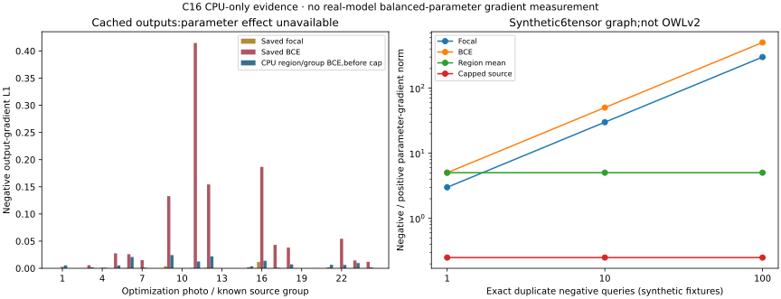

# Phase 10C.16 — Source-aware negative-gradient balancing

**Implemented, opt-in and disabled by default. CPU validation passed; no real-model inference or training occurred.** The method replaces only the added source-negative term with region/source-group mean BCE, then caps its *measured classification-head parameter-gradient contribution*. Positive, native-negative and box objectives remain the C8 definitions. The final real-model cap strength/direction is unmeasured: the available C11 caches cannot establish it for the required C8 parameter scope.

Parent: `66568c57826619cb36dac1205684968d7350f31e`. Branch: `experiment/phase10c16-source-aware-balancing`. Existing `.venv/bin/python`; no package, environment, dataset, annotation or production-default changes.

## Confirmed historical findings and definitions

C15R public/private seals, original source hashes and all 24 saved results were verified. Confirmed negative output-gradient L1 totals are focal **0.01750855** and BCE **1.13250373**. Mean per-photo projection-gradient L2 norms are **0.13118448 / 9.24055105**. Twelve of 19 covered groups have BCE negative norm above positive norm; ten of 24 total classification directions reverse; 272 of 281 negative queries score below 0.05; 17 of 41 source regions have no valid query coverage.

Those parameter measurements refer to the **two-tensor projection of the adapted C11 model with calibration frozen**. They are not original-pretrained C8 six-class-head gradients. Output-gradient mass sums each photo's GT-normalized derivatives; the reported parameter norm is a mean of photo norms, not the norm of a mean signed vector. No new precision, recall, AP or holdout score was calculated.

## Source and region concentration

The private source/region audit and public `source-group-audit.json` include every group, native annotation key/category/hash, source polygon hash, region/query IDs, confidence distributions, CPU region loss contributions, saved positive/negative projection norms, alignment and eligibility limitations. No validation images or outcomes were used to choose evidence or coefficients.

- **24 optimization photographs / 24 known source groups**, 41 existing source-supported regions, 281 admitted Chair-negative queries and 79 positive targets. These source groups are not proof of independent physical rooms.
- All 41 regions retain their existing native, photograph-bound evidence. They are automatic source-polygon negatives, **not new human confirmations**. Multiple regions or COCO/LVIS records are not asserted to be independent objects or captures.
- Three groups account for **66.47% of summed per-photo BCE projection norms**. This is a concentration statistic, not decomposition of a signed gradient.
- Source-negative queries produce **4,289 within-region box pairs**, of which **176 have IoU≥0.5**. Overlap is a geometry diagnostic, not proof of duplicate objects or false detections.
- There are **zero exact box/Chair-logit duplicate signatures** and no duplicate admitted region cells in this real cache. The duplicate handling is preventive and tested synthetically; it is not credited for the observed numerical reduction.
- **Three groups have no active positive Chair boxes**, but all have other verified furniture-positive targets. Their negative evidence remains active. No current C8 optimization photograph is a wholly negative-only row.
- Coverage stays **24 regions / 19 groups**. The other 17 regions and five groups contribute zero source supervision; their geometry and evidence are retained.

Region attribution is limited by what was saved. Seventeen uncovered regions have exact zero contribution. In 14 sole-covered-region cases, the saved photo-level source projection norm can be attributed to that region because it supplies the entire source branch. For the remaining **ten covered regions on five photos**, separate signed parameter vectors were not saved, so their individual projection norms cannot be recovered from a photo-level norm. No norm is divided according to query counts or output-gradient shares. Per-region loss reconstructions are CPU equivalents and retain their small floating-point deltas from saved GPU photo losses in `region-attribution.json`.

## Exact normalization formula

For source group `g`, let `R_g` count all unique verified region cells across its optimization-training photographs, including uncovered regions. Region aliases are preserved as provenance. Only exact same-image/category/rectangle supervision cells share a normalization unit; no product or physical-object identities are merged.

Each already-admitted query receives one owner: the lexicographically first canonical verified region that wholly contains it. Duplicate source records cannot count a query twice. For region `r`, `U_r` contains distinct detached **exact FP32 box + Chair-logit signatures**. Each signature `u` has query copies `D_u`. Near-duplicates are not silently merged.

```text
Lsource(i) = 0.75 / R_g × sum over regions r in photo i:
               [1 / |U_r| × sum over signatures u in U_r:
                   1 / |D_u| × sum over q in D_u BCEWithLogits(z[q,Chair], 0)]
```

An empty region contributes zero; if `R_g=0`, the source term is zero. Group/region denominators are fixed by existing evidence; query ownership and signature weights are detached from autograd. Identical query copies share one unit of weight, so extra copies do not inflate the scalar source loss or output-gradient mass. The same outputs can still have different upstream Jacobians, so no arbitrary duplicate-query **parameter-gradient invariance** is claimed.

The **source term's old sum/nGT divisor is replaced** by source-group/region/signature means. Existing positive and native-negative focal terms remain divided by their original active-GT count; 5×L1 and 2×GIoU remain unchanged. The coefficient 0.75 is the original negative alpha, not a fitted new weight. At the original microbatch accumulation stage, every branch loss is divided by actual group size **before** the scaled VJP, matching C8; scaled FP32 buffers are accumulated and unscaled once. The last group of three retains that exact normalization order.

All admitted/ignored masks are independently replayed against the executed objective. Ownership uses the original FP32 square coordinate frame, avoiding inverse-transform rounding expansion. Known Chair/seating-stool positives, ignored and additional protected regions remain blockers. No absent category annotation becomes background; the source term touches Chair only.

## One bounded parameter-gradient policy

The fixed engineering policy uses a **one-quarter positive-gradient budget**, selected without development scores, a coefficient sweep or accuracy tuning. Its purpose is an explicit local trust bound, not an empirically optimal weight.

Let `P` be the accumulated positive classification gradient for **all verified furniture positives**, and `N` the raw source-balanced gradient. Both are actual unscaled vectors across all six C8 classification tensors: projection weight/bias plus logit-shift and logit-scale weight/bias.

```text
if ||N|| = 0: s = 1
otherwise, with verified positive targets and ||P|| > 1e-8:
    budget = 0.25 × ||P||
    s = min(1, budget / ||N||)

Gclass = Gbase_class + stop_gradient(s) × N
Gbox   = Gbase_box
```

`Gbase` is the unchanged positive + native-negative + box objective **without** the old added-source focal branch. Only the new negative buffer is scaled. There is no projection, clipping or reweighting of the positive branch to make room for negatives. The cap is applied **after the entire fixed accumulation group**, not independently per photo; cancellation between positive microbatch gradients therefore cannot conceal an oversized group-level source term.

In the valid relative regime, `||sN||≤0.25||P||` within declared floating-point tolerance. Even with directly opposing gradients, `P·(P+sN)≥0.75||P||²`; the source perturbation alone cannot reverse the positive-plus-source direction. The maximum ideal angular deviation is `asin(0.25)`, about 14.5 degrees. Existing native-negative gradients remain unchanged and are not included in this guarantee. The original global clipping and AdamW/moments/weight decay occur later, so this is **not an optimizer-update or recall guarantee**.

Exceptional cases are explicit:

- No positive **Chair** labels is not a reason to remove negatives. Sofa/Bed or other verified furniture positives supply the same anchor.
- If known furniture positives exist but their nonzero-source anchor is absent or ≤1e-8, raise `PositiveAnchorUnavailable` and stop the update. Do not divide by a tiny number, silently drop evidence or fabricate a reference gradient.
- A genuinely verified negative-only group can retain nonzero source supervision under an absolute L2 budget **0.01**, defined as 1% of C8's unchanged global clip norm. This is a conservative engineering fallback, not a new fitted loss coefficient. It does not admit new rows into the present C8 dataset. The original baseline wrapper still enforces its positive-row eligibility; support for any future negative-only dataset requires explicit integration/approval.
- Zero coverage produces zero source loss/gradient and leaves the original base untouched. Nonfinite, scope, shape and buffer-budget violations fail closed.

The code uses actual branch VJPs, not a ratio of loss values or output gradients. `Accumulator` and `compose` return gradient buffers and diagnostics without mutating a model or constructing an optimizer. There is no training launcher in this phase.

## Cached CPU comparison

The new raw source term is evaluated on existing C11 logits and unchanged masks, **before the parameter cap**:

| Measure | Existing focal | Unweighted BCE | Region/group BCE, uncapped CPU |
|---|---:|---:|---:|
| Negative output-gradient L1 | 0.0175086 | 1.13250 | **0.144512** |
| Mean source-negative loss | 0.000287254 | 0.0483606 | **0.00619910** |
| Top-three group share of output-gradient L1 | 92.83% | 66.74% | **46.47%** |
| Saved mean projection-gradient L2 | 0.131184 | 9.24055 | **Unavailable** |
| Real-model capped gradient / dominance / direction | Historical only | Historical only | **Not measured** |

Raw normalized output mass is **8.25× focal** and **12.76% of unweighted BCE**. The lower output-space concentration is measured; it is not presented as a measured reduction in parameter-gradient concentration. The raw balanced output-gradient mass by confidence band is 0.034833 below 0.01, 0.059474 at 0.01–0.05, 0.031704 at 0.05–0.15 and 0.018501 at ≥0.15. Thus about 65% still acts on scores below 0.05. Region averaging can dilute rare harder queries among many easy ones; no extra hard-mining variant or confidence threshold was introduced.

An output-gradient bound is not a parameter-gradient bound: the upstream Jacobian can amplify, cancel or redirect contributions. C15R has neither the per-query pre-head features nor separate signed region vectors needed to calculate the new real-model result. Its calibration gradients were frozen. Even a uniform-weight rescaling of a saved norm would not establish the full C8 six-tensor result under AMP. Consequently all new real-model cap factors and parameter norms remain explicitly null. There is no claimed observed C dominance frequency or improved Chair precision/recall.

## Clearly labelled synthetic parameter tests

A fixed shared linear six-tensor graph compares 1, 10 and 100 exact duplicate negative queries with identical coefficients. These are duplication-sensitivity fixtures, not a hyperparameter sweep or OWLv2 inference.

| Duplicate copies | Focal negative/positive parameter norm | BCE ratio | Region mean ratio | Capped ratio |
|---|---:|---:|---:|---:|
| 1 | 3.0 | 5.03 | 5.03 | **0.25** |
| 10 | 30.0 | 50.29 | 5.03 | **0.25** |
| 100 | 300.0 | 502.87 | 5.03 | **0.25** |

The fixture uses maximally opposing gradients (cosine -1). The positive buffers and box buffers stay intact; the cap preserves positive-plus-source direction. Separate tests cover positive cancellation across microbatches, the last-three accumulation group, absent/near-zero anchors, no Chair positives, negative-only absolute budget, empty coverage, overlapping and duplicate regions, duplicates, extreme logits, source provenance, source isolation and deterministic weights.



## Future C8-comparable configuration and GPU gate

`future-experiment-disabled.json` prepares **one** future arm against immutable **C8 corrected Arm B**. It is disabled (`training_authorized=false`, `GPU_authorized=false`, method `enabled=false`). It retains original pretrained initialization, the same 59 training photos / 56 known groups / 182 positive boxes / 41 source regions, seed and ordering, batch one, accumulation four/last three, AdamW LR1e-5/betas/epsilon/weight decay, scale settings, positive/native/box losses, preprocessing and architecture.

**All 12 original head tensors are trainable: 1,579,526 scalars. Calibration shift/scale is trainable exactly as C8. No C11 freezing or C13 L2-SP is combined with this method.** The checkpoint loader interface was tested on the original C8 head payload in an isolated CPU head fixture; no new checkpoint was written.

The prerequisite is a separately approved zero-update smoke on **all 59 existing optimization photos**, in the exact first C8 epoch order: 15 complete accumulation groups, ending with three. The prior 24 probes alone would omit other positive anchors from the real accumulation groups. Proposed bounds: **59 forwards, at most 295 VJPs, 180 seconds, 6.5 GiB VRAM, 128 MiB new output, zero optimizer updates**. Exact IDs/groups/hashes and approval details are in the private photo proposal and public `next-approval-request.json`. No proposed experiment directory was created.

At most five VJPs per photograph compare positive, unchanged base, source focal, source BCE and normalized source on the same original-pretrained forward. The cap is then measured at the real group boundary. Source-to-region attribution can be logged from masks/output derivatives without extra model forwards; no unbudgeted per-region backward sweep is authorized by the proposal. Expected 2–4 GiB allocation and roughly 60–120 seconds are planning estimates, not measurements or guarantees.

Any later training requires a separate approval after that smoke. The prepared ceiling is one arm, five epochs / 75 updates / 600 GPU seconds / 6.5 GiB. Actual training integration needs separate source/base VJPs and FP32 accumulation buffers (at least three VJPs per microbatch instead of one backward), and compatibility checks for AMP additivity, scaler unscale order and the last-three group. No extra encoder forward is intrinsically required. Frozen/backbone gradients must remain absent. There is no automatic training activation or weight sweep if a guard fails.

## Evaluation, tests and preservation

The future protocol records precision/recall at0.15, precision at matched recall, PR curves, AP50/AP75, TP/FP/FN, Chair FP/misses, Sofa/Bed regressions, seven-category logit distributions, source/positive/native gradient contributions, grouping variability and duplicate/fragment diagnostics. It retains the historical matching, NMS and partial-label definitions. The exposed 19-image panel is descriptive only; it does not select coefficients or supply negatives. Frozen/reserved material remains unscored. Independent, fully annotated seven-class real-room evaluation is still necessary for the 60% development milestone and ultimate simultaneous 80% precision / 90% recall goal.

**150 CPU tests and 13 GPU-disabled browser checks passed.** The final results are recorded in `tests-v2.json` and `preservation-v2.json`; the earlier 149-test records remain preserved. Checks include parameter-key-order determinism. The browser checks cover the readonly source report, covered/uncovered filtering, provenance, explicit unavailable parameter measurements and absent write/model endpoints. An initial Windows-to-WSL connection-refused startup was corrected by waiting for legitimate localhost readiness; failed logs were preserved. No dependency was installed and no external content was acquired.

Historical verification passed for 9,973 model/data files plus C8/C11/C13/C14/C15R seals, source hashes, implementation snapshots and partition isolation. All original model weights and historical outputs remain unchanged. Zero new real-model forwards, training updates, downloads or human review decisions occurred. Only new isolated tools and small reports are committed; private caches and model files remain outside Git.

**Recommended next action:** review and separately authorize the single 59-photo, zero-update C8-scope gradient smoke. It is needed to establish actual balanced parameter strength, direction, cap activation and numerical behavior. Do not begin training on the basis of CPU output mass or synthetic cap tests alone.
