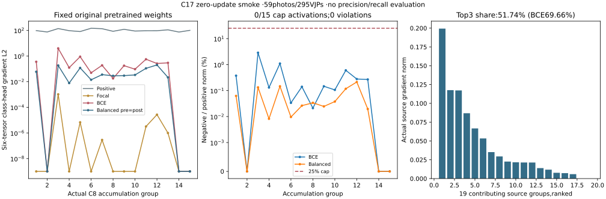

# Phase 10C.17 — Full-sequence balanced-gradient GPU smoke

**Completed. Qualified A: numerically promising for one separately authorized diagnostic training trial.** Balanced negatives reached 19 source groups versus seven for focal loss, with approximately 788× the mean negative-gradient norm. All accumulation groups respected the cap and preserved positive/box buffers; no classification direction reversed. This does not establish adequate learning pressure, improved identification, or any precision/recall milestone.

The most important limitation is that **the 25% cap never activated**. At original initialization the negatives were already extremely easy and their gradients remained very small relative to positives. The observed reduction from unweighted BCE therefore comes from source/region normalization, not clipping. No additional GPU variant was used to force activation.

## Execution and immutable initialization

Parent commit `8f4987348765e4cbd4a3dc6efca9f37598d55bf3`; branch `experiment/phase10c17-balanced-gradient-smoke`. Exactly one process used the existing `.venv/bin/python` and RTX 4070 Laptop GPU. There was no training, optimizer construction, parameter update, download, deployment, validation/frozen scoring or Phase 10D execution.

The exact first C8 epoch was reproduced: **59 optimization-training photographs, 56 known source groups, 182 active positives, 15 accumulation groups (14×4 plus one×3)**. All photo/evidence hashes, ordering and source-group assignments were verified. The model initialized from **original pretrained OWLv2 only**, with no adapted-head checkpoint loaded. All 12 original head tensors, including four calibration tensors, were gradient-enabled; vision/text/objectness and remaining parameters were frozen.

| Fingerprint | SHA-256 |
|---|---|
| Original immutable model file | `e1e130b9e404cf91a75ad45644c1da9d7fa5284085eecc864266a6923efb99e7` |
| Original 12-head bytes, matching C8 initialization | `6d95695bf79bf76dfacf722ba9d09f9e749088649ab36af588d70a01cda5030c` |
| Live full parameter/buffer state, before **and** after | `0dbbcbd11836dbbe370bbed85b153261b696e5c4f4e458cc502de6fc903a1d7b` |

All 24 photographs with original C8 cached probe outputs reproduced their logits and boxes **bit-identically**. The other 35 had no such cached original probe; no equality claim was invented for them. Full state fingerprints matched at all 15 accumulation boundaries and at completion. All model `.grad` fields stayed `None`: the diagnostic used returned VJP buffers, never an optimizer or parameter `.grad` assignment.

## Fixed methods, normalization and preflight correction

Five VJPs per photo used one identical forward graph: verified positive classification, unchanged positive/native/box base, added focal negatives, unweighted added BCE, and source-normalized BCE. Each differentiated `(branch_loss / actual_group_size) × 128`, preserving C8's scaling order including the final group of three. Scaled FP32 buffers were summed and unscaled once.

A is C8's added source-negative focal branch. B replaces that branch with trusted-negative BCE. C uses the unchanged C16 source/region/signature mean BCE and detached parameter-gradient cap. Native-negative and positive losses, box loss, matching, architecture, masks and protected regions remain identical. No scalar loss ratio substitutes for a parameter-gradient bound. Source gradients never reach box parameters. The added negative vector is compared across **all six classification-head tensors**, not just the projection.

CPU preflight caught a genuine **C16 diagnostic metadata collision**: `Accumulator.finish()` correctly composes capped buffers but overwrites its reported `scale` with the AMP scale 128. C17 leaves all C16 files unchanged and invokes the same unchanged `compose` on the same unscaled buffers, recording `scale` (cap factor) and `amp_scale` separately. An active-cap CPU regression proves bit-identical output buffers between wrappers. No cap coefficient, algorithm or mask changed. This was fixed before any GPU forward; failed preflight logs/configuration versions are retained.

The final pre-GPU gate passed **44 CPU tests**, including all original cached-mask comparisons, exact 12-head scope, source/positive routing, normalization order, sequence checks and the metadata regression. The GPU worker's code/input binding remained immutable during execution.

## Actual magnitude comparison

These are **means of 15 accumulation-group vector norms**, including zero-source groups, all at fixed original weights. They are not training updates or means of per-photo unnormalized gradients. C15R used a trained C11 model, frozen calibration and a different normalization scope, so its numeric magnitudes are not treated as a matched baseline here.

| Source-negative method | Mean six-tensor gradient norm | Active accumulation groups | Active source groups | Top-three source share |
|---|---:|---:|---:|---:|
| A — focal | 0.00007070 | 6/15 | 7/56 | 99.27% |
| B — unweighted BCE | 0.461022 | 12/15 | 19/56 | 69.66% |
| C — source-balanced, pre-cap | 0.0557385 | 12/15 | 19/56 | 51.74% |
| C — source-balanced, post-cap | 0.0557385 | 12/15 | 19/56 | 51.74% |

Mean positive classification-gradient norm was **101.2198**. For active groups, C's negative/positive norm ratio ranged **0.00820%–0.21405%**, median **0.03580%**. Thus the improvement over nearly zero focal signal is real, but the absolute relative strength at initialization is still weak. No lower-bound effectiveness or eventual recall/precision benefit is claimed.

**Cap activations: 0/15 (0%). Cap violations: 0/15.** Every measured post-cap vector and the effective FP32 perturbation after addition stayed below 25% of the measured positive norm. The actual factor was 1 for every group; the AMP scale was 128. Numerical clipping at a binding cap was tested on CPU, not naturally exercised on real-model data. A future training trial must monitor whether and how it activates as weights evolve.

The logged comparisons add isolated FP32 branch buffers to the same base. They are not asserted to be bit-identical to hypothetical separate single-backward AMP objectives; branch summation can round differently upstream. All methods here share the same measurement definition and outputs. No optimizer behavior is inferred from these vectors.

## Gradient direction, calibration and box preservation

Balanced negative gradients oppose positive gradients in all 12 source-bearing accumulation groups: cosine approximately **-0.9666 to -0.9275**. No combined classification vector reverses relative to positive learning: **0/15 reversals** for focal, BCE or balanced. Positive-plus-source directional checks and bitwise unchanged positive accumulation buffers passed. The unchanged base contains existing native negatives as well; no additional native-negative gradient sweep was performed.

All six box-head buffers were bit-identical before/after C composition. Positive/source classification branches had no box-head gradient path, and all protected/positive target checks passed. Original global clipping and AdamW were only verified as configuration; neither was applied to the model. Future global clipping and Adam's adaptive normalization can change update magnitudes, so the 25% gradient bound is not a parameter-update or performance guarantee.

Maximum individual-tensor post-negative/positive norm ratio over the 15 groups:

| Classification tensor | Maximum ratio |
|---|---:|
| `dense0.weight` | 0.2326% |
| `dense0.bias` | 0.2288% |
| `logit_shift.weight` | 0.2118% |
| `logit_shift.bias` | 0.2073% |
| `logit_scale.weight` | 0.5261% |
| `logit_scale.bias` | 0.5138% |

No tensor had an opposing negative norm larger than its positive norm; none had zero positive norm with nonzero source norm. The aggregate cap does not promise such per-tensor bounds at later model states, so these remain required diagnostics.

The actual mean of 15 update-normalized vectors gives positive projection/shift/scale norms **30.7944 / 95.6175 / 0.777069**, versus balanced-negative **0.0187643 / 0.0518715 / 0.000900416**. Initial positive pressure is dominated by logit-shift parameters. The full mean-vector negative/positive ratio is **0.05492%**. This global calculation uses retained actual vectors, not reconstruction from scalar norms; the contractual cap itself remains per accumulation boundary, not a bound relative to a potentially cancelling global mean.

## Coverage, concentration and easy-negative limitation

Source queries remain restricted to the original 41 independently admitted source-polygon records. There are **292 source-supported Chair-negative query terms**, 8,523 unchanged native-negative terms, 182 positives and **1,477,803 ignored terms**. No unannotated region or other furniture category was converted into background.

- **24/41 regions** receive query coverage; 17 remain uncovered.
- **19/56 known source groups** contribute nonzero C gradients. Five groups have admitted regions but no query coverage, and 32 have no source-negative regions.
- All 15 accumulation groups contain positive Chair targets. Three source-bearing photographs lack positive Chair boxes but retain other verified furniture positives and were included. Chair-free/negative-only accumulation and unusable-positive-anchor fallbacks were not naturally exercised; their safe behavior remains covered by CPU tests.
- Zero exact duplicate query signatures were encountered. The observed improvement in concentration is from region/group averaging, not an observed duplicate-removal effect. Near-duplicates are not silently merged.
- The top three C groups contribute 51.74% of the **sum of per-source vector norms**, down from BCE's 69.66%. This remains uneven and is not a decomposition of the norm of a signed global sum. Known creator/source groups do not establish independent physical rooms.
- Negative Chair scores have median **0.000157964**, 90th percentile **0.00112274**, and maximum **0.0190509**. Every one of the 292 terms scores below 0.05; none exceeds 0.15. Supervision beyond extremely easy negatives is therefore **not demonstrated**.

No admitted source target was removed by normalization or the cap, and every covered source group has a nonzero normalized aggregate gradient. This does not prove every individual query survives upstream AMP rounding with a distinct nonzero parameter contribution. Focal's zero groups despite available queries illustrate the distinction between an admitted target and effective numerical signal.

CPU replay verified every individual normalization weight bit-for-bit. Only the *sum* of those same FP32 weights differed by about one ULP between CPU/GPU reductions on photos 35 and 48. The report validator permits a declared tolerance for that scalar metadata field while requiring exact weights, structure and masks; no inference, geometry or algorithm was repeated or changed.

## Resource and integrity accounting

| Measurement | Actual |
|---|---:|
| GPU launches | 1 |
| Model forwards | 59 |
| Gradient calculations | 295 |
| Completed photographs / known groups | 59 / 56 |
| Worker elapsed time | 44.4935 seconds |
| Launcher wall time | 45.2329 seconds |
| Peak allocated VRAM | 1,721,039,872 bytes / 1.60284 GiB |
| Peak reserved VRAM | 2,327,838,720 bytes / 2.16797 GiB |
| Peak sampled device use | 3,612,868,608 bytes / 3.36475 GiB |
| Optimizer steps / parameter updates | 0 / 0 |

All bounds were respected. Outputs are isolated under the C16-proposed smoke destination `data/open-images/experiments/phase10c16-balanced-gradient-smoke-v1/`, with C17 reports here. Raw arrays, per-photo receipts, accumulation/source statistics and periodic resource/fingerprint telemetry were saved atomically. Pending links are retained and conservatively counted toward the 128 MiB guard. Allocation snapshots and final seals record disk use; no weights were written.

**168 CPU tests passed after the smoke**, in addition to the 44-test preflight. Historical preservation verified 9,973 data/model files plus previous phase seals, source hashes, initialization fingerprints and partition isolation. Original OWLv2, all prior head/classifier checkpoints, annotations, cached predictions and prior results remain unchanged. No reserved/frozen photograph was decoded or scored. No new browser workflow was needed for this measurement-only phase.

## Training-readiness decision and one disabled proposal

The qualified A supports **one controlled diagnostic trial**, because source gradients are finite, reach 19 groups, exceed the old focal signal substantially, obey the measured bound, preserve positive/box buffers and introduce no widespread direction reversal. It does **not** establish strong enough negative learning, natural cap activation after adaptation, useful hard-negative coverage or independent accuracy. Unweighted BCE also stays below the cap at original initialization; its earlier excess was observed at a different, trained state. No conclusion that BCE is always unsafe or that normalization alone fixes detection is supported.

`future-training-disabled.json` prepares one arm against immutable C8 corrected Arm B, with original pretrained initialization, same 59/56/182/41 data, seed6106/order, batch1/accumulation4-last3, LR1e-5 and unchanged AdamW/loss/box/preprocessing/evaluation definitions. All 12 head tensors including calibration remain trainable; vision/text/objectness remain frozen. There is no C11 freeze, C13 regularizer, new threshold, label or dataset. The corrected diagnostic metadata adapter is recorded explicitly; gradient buffers remain the unchanged C16 algorithm.

Proposed future ceilings: **five epochs / 75 optimizer updates / 600 GPU seconds including diagnostics / 6.5 GiB VRAM / 467 forwards / 4 GiB new output**. The 467-forward ceiling includes budgeted initialization probes and historical diagnostic evaluation; no extra unbounded GPU queue is proposed. Resource estimates are not measured training results. Checkpoints would use fresh versioned paths and existing 12-head loading compatibility. No future training directory or launcher has been created.

The future endpoint is fixed at epoch5/update75. The already-exposed 19-image panel is descriptive only, under its original partial-label rules; matched-recall precision, AP50/AP75, Chair misses/FP, Sofa/Bed regressions, duplicate/fragment diagnostics and seven-category logit distributions must be reported without tuning coefficients against that panel. Only three classes have active training positives. Independent fully annotated seven-class real-room data is still required for the 60% development milestone and ultimate simultaneous 80%-precision/90%-recall claim.

**Recommended next action:** separately authorize the single bounded diagnostic training trial after final trainer implementation/tests and immutable binding. Monitor source strength, cap activation and tensor-level conflicts as weights evolve. No training follows this session automatically, and no precision/recall improvement has been claimed.
