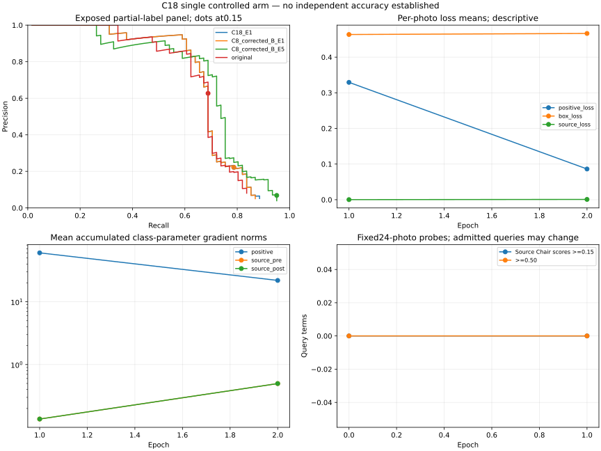

# Phase 10C.18 — Controlled source-balanced training: safety-stopped

**Outcome D — inconclusive.** Exactly one arm was attempted and stopped safely before optimizer update29, after28 committed updates. No retry, resume, extra inference, additional variant or Phase10D execution followed. The requested epoch5 endpoint was not reached.

Only epoch1/15-update prediction artifacts exist. They were fully saved atomically during the GPU process; unchanged metrics ran later in a separate CPU-only process. Checkpoint28 is preserved but has not been scored. No missing endpoint metrics are inferred.

## Authorization, preflight and comparison fidelity

Parent `00b372072f52fbab8cebaa308b96a395c6f3e6f8`; branch `experiment/phase10c18-source-balanced-training`. Preflight verified original OWLv2, C8 corrected Arm B settings, C16 code and source evidence, all C17 public/private seals,59 optimization photos/56 known groups/182 existing positives/41 admitted source regions. Every one of75 proposed data groups matches the historical C8 order. No labels, partitions or scopes changed.

Original12head tensors, including all4calibration tensors, remained trainable; vision/text/objectness and all remaining parameters were frozen. LR1e-5, seed6106, AdamW(.9,.999),eps1e-8,weight_decay.01, global clip1, batch1/accumulation4(last3), initial scale128/growth2000 are unchanged. Original initialization was verified against C8 head/frozen fingerprints. All24 initial probe outputs matched original C8 outputs bit-for-bit.

The sole intentional objective change is the C16 trusted Chair-negative source/region/duplicate-normalized BCE with detached25% accumulated six-class-tensor gradient cap. Positive/native-negative/box losses, matching, labels and ignored/protected regions remain unchanged. The existing C17 metadata adapter separates cap scale from AMP scale without modifying C16 code. Three scaled VJPs compose base/source gradients, then use unchanged GradScaler unscale/global clipping/AdamW. This is the required implementation of balancing; upstream AMP branch-rounding is not claimed bit-identical to C8 single-backward summation. No calibration freeze or projection regularization was added.

56 CPU tests passed before CUDA, including all59cached photograph masks and weights, actual CPU GradScaler/AdamW transfer, active-cap synthetic tests, C16 normalization and historical loss regression. Preflight configuration versions, logs and bindings are preserved.

## Safety stop and confirmed versus inferred causes

`update18.compose_checked` raised `ValueError: Measured cap violation` after processing the fourth photo of epoch2/group14, before assigning gradients or writing optimizer intent29. The optimizer post-hook and saved optimizer states both establish28 updates. The four pending photographs contributed forward/VJP work only.111 photograph presentations fed committed steps;115 training forwards ran in total.

The unmodified C16 `compose` returned through its own finite-value and intended-source-cap checks. C18 then checks both the intended post-cap source vector and the effective FP32 perturbation `composed - base`. No objective or guard was repaired during/after GPU execution, and no update29 or automatic recovery occurred.

A deterministic **synthetic CPU witness**, not the failed GPU buffers, demonstrates a false-positive mechanism: valid source norm/budget `0.0008660254449184381`, versus `0.0008721569313014672` after FP32 addition/subtraction of a larger base (0.708% excess). The original strict guard rejects this valid intended-source cap. The CPU regression now documents that behavior; it does not weaken or replace the executed guard.

**The failed GPU group's positive/source/budget/effective values were not retained.** A rounding-related effective-difference rejection is strongly suggested by the code path and CPU witness, but the exact failed inequality and cap factor cannot be measured retrospectively. It would be incorrect to claim an actual numerical excess, successful clipping activation, or corrected recovery for that group. A future review must instrument pre-error vectors/scalars and derive a defensible FP32 measurement tolerance without relaxing the intended25% cap.

## Available detection comparison

All entries below use the identical19-photo exposed training-derived panel,61retained positives, confidence0.15, NMS0.5/cap300, AP score floor0.001 and unchanged101-point supported-class AP50/AP75. CPU reconstruction reproduced every historical reference metric exactly. C18E1 versus C8E1 is the update-matched comparison. C8E5 is a requested historical reference at a different duration, not evidence of a treatment benefit.

| Model | Updates | Precision | Recall | AP50 | AP75 | TP / FP / FN |
|---|---:|---:|---:|---:|---:|---:|
| original | 0 | 62.69% | 68.85% | 74.99% | 55.28% | 42 / 25 / 19 |
| C8_corrected_B_E1 | 15 | 22.22% | 78.69% | 76.53% | 57.98% | 48 / 168 / 13 |
| C8_corrected_B_E5 | 75 | 6.86% | 95.08% | 75.25% | 55.21% | 58 / 788 / 3 |
| C18_E1 | 15 | 22.22% | 78.69% | 76.58% | 58.02% | 48 / 168 / 13 |

At matched original recall68.85%, descriptive PR-envelope precision is68.85% for original,66.67% for C8E1 and66.67% for C18E1; C8E5 is80.77%. At matched C8E1 recall78.69%, C18E1 is23.30% versus23.19% for C8E1 (one fewer ranked FP). These are descriptive curve points, not adopted confidence thresholds or independent tests. The very small ranking difference does not establish a reliable gain.

| Model / category | Precision | Recall | TP / FP / FN | AP50 | AP75 |
|---|---:|---:|---:|---:|---:|
| original / chair | 55.81% | 61.54% | 24 / 19 / 15 | 55.46% | 31.75% |
| original / sofa | 91.67% | 84.62% | 11 / 1 / 2 | 90.10% | 69.31% |
| original / bed | 58.33% | 77.78% | 7 / 5 / 2 | 79.41% | 64.78% |
| C8_corrected_B_E1 / chair | 16.77% | 71.79% | 28 / 139 / 11 | 59.12% | 36.80% |
| C8_corrected_B_E1 / sofa | 70.59% | 92.31% | 12 / 5 / 1 | 89.75% | 69.31% |
| C8_corrected_B_E1 / bed | 25.00% | 88.89% | 8 / 24 / 1 | 80.71% | 67.83% |
| C8_corrected_B_E5 / chair | 5.78% | 100.00% | 39 / 636 / 0 | 66.87% | 43.41% |
| C8_corrected_B_E5 / sofa | 28.21% | 84.62% | 11 / 28 / 2 | 79.35% | 55.45% |
| C8_corrected_B_E5 / bed | 6.06% | 88.89% | 8 / 124 / 1 | 79.52% | 66.79% |
| C18_E1 / chair | 16.77% | 71.79% | 28 / 139 / 11 | 59.28% | 36.91% |
| C18_E1 / sofa | 70.59% | 92.31% | 12 / 5 / 1 | 89.75% | 69.31% |
| C18_E1 / bed | 25.00% | 88.89% | 8 / 24 / 1 | 80.71% | 67.83% |

Table, Desk, Cabinet and Lamp have no supported evaluation positives/negative scope and remain **unassessed**, not zero-error categories. Native taxonomy and LVIS completeness flags are unchanged; seating/bar stools stay protected under the project policy without silently rewriting historical native Chair semantics.

At confidence0.15 C18E1 has572unknown/unassessable unmatched detections across all7categories, including112Chair predictions. They are separate from168scored FPs, including139Chair FPs. FP completeness covers only4Chair photographs,1Sofa and5Bed; annotations are incomplete elsewhere. Unmatched predictions outside covered scopes are not confirmed errors. At0.80 C18E1 and C8E1 each have1scored Chair mismatch plus2unknown unmatched Chair predictions; C8E5 has39scored Chair mismatches plus36unknown unmatched. No manual visual mistake labels were fabricated.

Duplicate scored FP counts at0.15 are1for original,1for both C8E1/C18E1, and4for C8E5. Fragmentation candidates are4/19/19/47 respectively; mixed-object candidates15/34/34/79. These latter counts are unchanged metric heuristics, not human-confirmed failure classifications. Sofa precision falls91.67%→70.59% and Bed58.33%→25.00% relative to original, despite higher recalls; both equal C8E1. Matched IoU values and all seven native category fields are retained in `category-metrics.csv`.

## Confidence drift and discrimination

C18E1 broad mean aligned-query logit drift is+1.77475 versus+1.77594 for C8E1 and+4.25294 for C8E5. Chair mean drift is+2.33084 versus+2.33375 at matched epoch1. All7categories shift upward. This is descriptive aligned-query drift on the same backbone, not a causal projection/shift/scale attribution.

| Model | Raw Chair queries >=0.15 | >=0.50 | >=0.80 |
|---|---:|---:|---:|
| original | 82 | 3 | 0 |
| C8_corrected_B_E1 | 553 | 68 | 10 |
| C8_corrected_B_E5 | 4855 | 926 | 161 |
| C18_E1 | 553 | 68 | 10 |

C18E1 and C8E1 have identical fixed-threshold TP/FP/FN and raw Chair counts. AP50 differs by only+0.056percentage points, AP75+0.037points, favoring C18E1. The small score/ranking changes are not proof of improved discrimination, confidence calibration or generalization. Broad inflation is already present at epoch1; no training-based final conclusion is possible after the stop.

## Measured learning signal before the stop

All28committed accumulation boundaries passed intended cap, protected-mask, positive/base-box buffer, AMP transfer, finite-value and exact parameter-scope checks. No committed source cap activated. The failed29th boundary remains unknown and is not counted as a measured successful cap.

| Training segment | Committed updates / photos | Mean positive class norm | Source pre / post norm | Mean positive / source projection norm | Largest source/positive ratio |
|---|---:|---:|---:|---:|---:|
| Epoch1 | 15 / 59 | 60.134236 | 0.135721 / 0.135721 | 18.693270 / 0.046282 | 1.16% |
| Epoch2 (partial) | 13 / 52 | 21.882166 | 0.498213 / 0.498213 | 6.478175 / 0.168228 | 9.21% |

These are means of committed update-normalized parameter norms; epoch2 contains13/15groups and is not directly a full-epoch matched population. Positive/source cosines remain opposing (epoch1 about-0.962to-0.918; partialepoch2-0.967to-0.882). Negative influence rises while positive gradients decline. Per-update scalar losses, all6tensor norms, cap factors and directions are in `update-gradient-history.csv` and immutable private receipts. Per-image loss means are descriptive; the detached parameter cap does not define a conventional single scalar capped loss.

On the fixed24-photo training probes, source queries292→293, covered source groups19→20 and regions24→25. Median trusted-negative Chair confidence0.000158→0.000830, maximum0.01905→0.07464. Mean per-photo source gradient norm0.13985→0.73251; the positive mean121.951→46.451. During the committed portion of epoch2 the maximum negative confidence reaches0.11636, still below0.15. **No observed source target reaches the predeclared difficult threshold0.15**, and none reaches0.50. Thus harder real false-positive supervision remains unproven. Dynamic matching/box changes can alter admitted-query membership; these are fixed photo/region probes, not fixed individual query cohorts.

Epoch1 top3source share is52.57% of the sum of source-group accumulated-vector norms. Epoch2 source-vector aggregates were not saved before the stop and are not reconstructed from norms. Every committed group retains positive/box preservation flags; no source terms were promoted from ignored regions. No positive-source combined-direction reversal was recorded.

All12heads were updated. Per-epoch projection displacement and actual calibration parameter values are preserved in `training-curves.json` and private `parameters-epoch-*.json`; the final checkpoint contains all12heads, optimizer, scaler and RNG cursor. The last full live frozen hash was checked at epoch1, not after failure. Original on-disk model hashes and all historical checkpoints remain unchanged; this does not invent a missing final live-memory fingerprint.

## Resources, recovery and preservation

The worker stopped after83.3238seconds; launcher wall time84.1397seconds. Exactly182forwards =115training +48probe +19evaluation. Gradient calls:345training +144probe. Peak allocated2024574464bytes (1.88553GiB); reserved2327838720bytes (2.16797GiB); sampled device3614965760bytes (3.36670GiB). All time/VRAM/update/download bounds were respected.

Latest immutable checkpoint: `data/open-images/experiments/phase10c18-source-balanced-v1/checkpoints/update-028-0520b171.pt`. SHA-256 `77081cb4ef7775a8f83c2b17475bf275847f9c0305f1984b66354a9880a2eefa`. This is update28, not the scored epoch1 checkpoint or a selected production model.29snapshots including initialization were independently reloaded and verified. Recovery would need the same RNG/optimizer/data cursor and separate approval; no resume command is offered while the cap guard remains unresolved.

Post-run35CPU tests passed, following56preflight tests. Historical preservation verified9973prior data/model files, C8private seal and C11/C13/C14/C16/C17seals. Source models, datasets, partitions, prior predictions and Mac project were not modified. Disk allocation snapshots and private SHA-256 seals include retained atomic pending links. Only small code/reports are eligible for Git; private photos, weights, snapshots and raw arrays remain local.

## Decision and next action

**D — inconclusive due to incomplete safety-stopped execution.** The available matched epoch1 evidence shows no fixed-threshold Chair FP reduction, no precision/recall benefit and nearly unchanged broad inflation. Tiny PR-ranking differences are insufficient to classify the complete proposed method as promising or ineffective. Source gradients grew, but still targeted easy negatives and no committed cap activation was demonstrated.

The60%precision development milestone is not met by C18E1. No independent seven-class80%precision/90%recall claim is supported; the exposed partial-label19-photo panel cannot establish it.

**One recommended next action:** a CPU-only numerical audit/repair of the extra effective-difference safety measurement, with durable pre-error gradient/budget telemetry and new active-cap rounding tests. Preserve the intended25%source cap and positive/box objective exactly. Only after that preflight should a separately authorized recovery from immutable checkpoint28 be considered, without replaying committed updates or changing the fixed endpoint. No training, inference or automatic continuation is authorized by this report.
