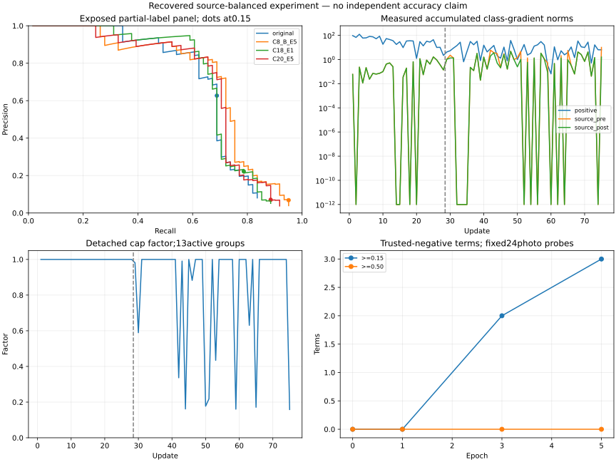

# Phase 10C.20 — Completed source-balanced recovery

**Completed the one authorized recovery:47 additional updates,75 total. Source balancing has not demonstrated a useful precision–recall advantage over C8 corrected Arm B. No further training, variants, deployment or Phase10D followed.**

## Recovery fidelity and limits

Parent `d34d73634bdb2d4c8a738029803bbe23c3d2d8c9`; branch `experiment/phase10c20-source-balanced-recovery`. The runner reconstructed the immutable original frozen OWLv2 backbone and loaded checkpoint28 head weights, all12AdamW moment states, scaler128/growth tracker28, exact parameter order and sampler cursor. No forward or optimizer step ran with original fresh heads. Recorded Python/PyTorch CPU/CUDA RNG states were restored LAST and exact device RNG set/get equality passed. The first training group was epoch2/group14, producing update29.

This is verified restoration of the saved optimization state and intended data sequence, not proof of bitwise equivalence to an unavailable uninterrupted execution. C18 did not record NumPy RNG; static checks found no NumPy random calls in its worker/loss/data-order path. No saved state was invented or substituted. Recovery checkpoints now record NumPy state without consuming it; its absence was not critical to the unchanged deterministic path. There was no scheduler in C18.

The loss/LR/rho/matching/source evidence,59optimization photos/56known groups/182positive boxes, partial-label masks, all12trainable heads (including calibration), source-region/query normalization, original global clip1 and AdamW settings are unchanged. No L2-SP, calibration freezing, new negatives or threshold changes were introduced. Only C19 direct cap verification and recovery/telemetry control changed. No committed update or initial probe was repeated; exactly four previously uncommitted forwards were replayed.

Pre-GPU tests passed73checks, including restoration on CPU, numerical guard, source normalization, unchanged optimizer/preprocessing/measurement functions, write-path safety and historical preservation. A pre-GPU test-selection revision was versioned: C19’s old assertion that this formerly future destination was absent became inapplicable after explicit C20 authorization. All other C19 guard/restoration checks were retained. The active binding and original version are preserved; this did not change the worker or objective.

## Fixed protocol comparison

Exact same19already-exposed internal-development photographs and61retained GT boxes; FP32 inference, confidence0.15, NMS0.5/cap300, score floor0.001, unchanged101point macro AP50/AP75 over the three supported classes. All historical prediction/metric reconstructions matched exactly. GPU raw predictions were atomically complete before CPU metrics; postprocessed predictions were also persisted before metric calls in a separate CPU-only process. Epoch3diagnostics were descriptive; the endpoint remained predeclared update75.

| Model | Updates | Precision | Recall | AP50 | AP75 | TP / FP / FN |
|---|---:|---:|---:|---:|---:|---:|
| original | 0 | 62.69% | 68.85% | 74.99% | 55.28% | 42 / 25 / 19 |
| C8_B_E5 | 75 | 6.86% | 95.08% | 75.25% | 55.21% | 58 / 788 / 3 |
| C18_E1 | 15 | 22.22% | 78.69% | 76.58% | 58.02% | 48 / 168 / 13 |
| C20_E5 | 75 | 7.07% | 88.52% | 73.15% | 54.74% | 54 / 710 / 7 |

At confidence0.15, total scored FP falls788→710, but TP falls58→54. Precision gains only0.21percentage points while recall loses6.56points; AP50 loses2.09points and AP75 loses0.47points. This is not a useful precision improvement at preserved recall.

At original recall68.85%, descriptive PR-envelope precision is80.77% for C8E5 versus75.00% for recoveredE5. At a recall requirement of at least88.52%, C8’s envelope reaches15.71%precision (90.16%recall) versus14.75%precision (88.52%recall) for recovery; discrete score ties mean operating recalls need not be identical. The recovered model cannot match C8’s95.08%recall under the unchanged floor/NMS protocol. This is not asserted to be an intrinsic all-query recall ceiling. No envelope threshold was adopted or used to retune the model.

| Model / category | Precision | Recall | TP / FP / FN | AP50 | AP75 |
|---|---:|---:|---:|---:|---:|
| original / chair | 55.81% | 61.54% | 24 / 19 / 15 | 55.46% | 31.75% |
| original / sofa | 91.67% | 84.62% | 11 / 1 / 2 | 90.10% | 69.31% |
| original / bed | 58.33% | 77.78% | 7 / 5 / 2 | 79.41% | 64.78% |
| C8_B_E5 / chair | 5.78% | 100.00% | 39 / 636 / 0 | 66.87% | 43.41% |
| C8_B_E5 / sofa | 28.21% | 84.62% | 11 / 28 / 2 | 79.35% | 55.45% |
| C8_B_E5 / bed | 6.06% | 88.89% | 8 / 124 / 1 | 79.52% | 66.79% |
| C18_E1 / chair | 16.77% | 71.79% | 28 / 139 / 11 | 59.28% | 36.91% |
| C18_E1 / sofa | 70.59% | 92.31% | 12 / 5 / 1 | 89.75% | 69.31% |
| C18_E1 / bed | 25.00% | 88.89% | 8 / 24 / 1 | 80.71% | 67.83% |
| C20_E5 / chair | 5.98% | 92.31% | 36 / 566 / 3 | 63.82% | 42.10% |
| C20_E5 / sofa | 26.32% | 76.92% | 10 / 28 / 3 | 76.24% | 55.45% |
| C20_E5 / bed | 6.45% | 88.89% | 8 / 116 / 1 | 79.41% | 66.69% |

Chair remains the largest scored error source:566/710FP (79.7%). Chair FP falls636→566, but three Chairs become misses (recall100%→92.31%). Sofa loses one additional TP, with FP unchanged28; Sofa recall84.62%→76.92%. Bed retains8TP/1FN while FP falls124→116. Table/Desk/Cabinet/Lamp have no supported GT or complete negative scope and remain unassessed, never zero-error categories. Native labels, seating/stool protections and LVIS completeness policies were preserved.

The panel is partially annotated: FP completeness covers only4Chair photos,1Sofa and5Bed. Unknown/unassessable predictions at0.15 are2434for C8E5 versus2161for recovery, separate from scored FP788/710. Do not label these unknown predictions mistakes. Scored mismatches at0.80 fall40→32, with losses in recall; separate per-category unknown and true-positive counts are in `results.json`.

Scored duplicate FP falls4→3. Fragmentation candidates remain47, mixed-object candidates79→81 and category-disagreement candidates28→31. The latter are geometric heuristics, not manually confirmed errors. On common GT matches, mean IoU decreases about0.01657for Chair,0.00268for Sofa and0.000158for Bed. Chair has two downward versus one upward0.75IoU crossings; recovery gains no additional GT matches at0.15 relative to C8E5.

## Confidence inflation and learning signal

All seven aligned query-category logits still drift upward. Mean all-category drift decreases only+4.25294→+4.11992; Chair mean drift+5.42252→+5.16089. Raw Chair queries above0.15/0.50/0.80 decline4855/926/161→4039/753/132. Broad inflation is reduced modestly, not prevented. Together with lower AP and worse matched-recall precision, these counts are consistent with score suppression plus changed ranking, not demonstrated better discrimination. This is descriptive alignment, not causal decomposition of shift/scale/projection.

| Epoch | Positive class-gradient norm | Source pre / post norm | Active caps /15 | Source terms >=0.15 |
|---|---:|---:|---:|---:|
| 1 | 60.134236 | 0.135721 / 0.135721 | 0 | 0 |
| 2 | 19.599455 | 0.653630 / 0.590513 | 2 | 0 |
| 3 | 12.070512 | 1.299180 / 0.863920 | 3 | 1 |
| 4 | 10.669730 | 1.510120 / 1.084905 | 5 | 2 |
| 5 | 9.868756 | 2.117928 / 1.193687 | 3 | 3 |

**13/47 recovery groups activated the cap (27.66%);13/75 total groups (17.33%). Zero genuine cap violations, nonfinite events or positive/protected/box-buffer violations occurred.** The source/positive ratio before the cap reaches about1.577, then stays at25%within the derived FP32 arithmetic allowance. The smallest applied coefficient is0.15849. Negative/positive directions remain opposing; the cap bounds only the added six-class-parameter vector before unchanged global clipping/AdamW, not parameter-update norms.

At the replayed update29 boundary, positive norm4.20633, raw source norm1.07169 and coefficient0.981239 yield source norm1.05158at budget1.05158. These are actual **recovery** measurements; the missing original failed-group values remain unavailable and are not retroactively claimed recovered. Pre-cap norms/hashes, context, fingerprints and optimizer availability were atomically saved before each guard.

Trusted negatives become somewhat harder, but sparsely: the fixed24-photo epoch5probe has288terms, only3above0.15 and none above0.50; maximum confidence0.26020, median0.006784. Mean per-photo uncapped source norm grows0.13985at initialization→5.36902at epoch5, while positive norm falls121.951→10.2975. Query/region admission can change with boxes/matching; this is a fixed-photo/region population, not a fixed individual-query cohort. Source coverage remains19known groups/24regions at epoch5. Large numbers of scored Chair mistakes are therefore poorly represented by genuinely difficult supervised source negatives.

Per-update losses, all six tensor norms, cap coefficients, directions and parameter drift are retained. Calibration remains trainable throughout. Epoch2source-vector concentration is honestly marked as resumed groups14–15only; pre-stop groups1–13vectors were not available. Whole-epoch scalar/loss/ratio statistics combine all committed receipts correctly, but missing signed vectors were not fabricated.

## Runtime, storage, checkpoints and preservation

Recovery worker runtime **145.5585s**; launcher wall time146.3124s. Combined launcher time across both attempts is230.4522s, below600s. Exactly270new forwards =184training +48training-only probes +38internal diagnostics;452cumulative =299training (295committed presentations plus4failed/replayed overhead) +96probes +57diagnostic forwards. New VJPs552training +144probe. Committed updates28+47=75.

Peak allocated VRAM2024102400bytes (1.88509GiB); reserved2340421632bytes (2.17969GiB); sampled device3627548672bytes (3.37842GiB). All stay below6.5GiB.

Before final seals, new output allocation is1838546944bytes conservatively counting retained pending hardlinks twice; unique-inode allocation is919425024bytes. Both are below2.5GiB; combined old+new conservative allocation is also below4GiB. Final seal/resource snapshots record later small report/manifest overhead.

Fixed endpoint checkpoint: `data/open-images/experiments/phase10c19-recovery-v1/checkpoints/update-075-d1c79472.pt`; SHA-256 **`c582d188cad04989bf170a7f9cb3cafaaf37d90f7b15568c3c005ea7699b82e2`**. It is an experimental endpoint, not a replacement or production-selected detector. All47new snapshots were atomically completed, independently reloaded and byte/state/cursor verified. Checkpoint28 remains unchanged.

Post-run9CPU tests passed after73preflight tests. Historical verification checked9973data/model files plus C8/C17/C18/C19seals. Frozen parameter hashes match restored original backbone at every epoch and completion; no frozen parameter received an optimizer slot/gradient. OWLv2 original, prior adapted detectors, SigLIP2 classifiers, datasets, source evidence, partitions and historical predictions remain unchanged. No packages/downloads, Mac-project modifications or reserved/frozen evaluation occurred.

## Decision and one next direction

**The current source-balanced negative objective has not demonstrated a useful performance advantage.** It changes learning and successfully exercises the cap, but the modest FP reduction costs recall, AP and matched-recall precision. It neither prevents broad confidence inflation nor reaches60%precision with useful recall preservation. The exposed partial three-class panel cannot establish the independent seven-category80%precision/90%recall requirement.

**Next direction:** improve source-supported hard-negative coverage for training-only high-confidence Chair confusers before another model-training design. Audit saved mistakes against trustworthy native completeness/evidence, keep real or ambiguous seating and all uncertain regions protected/ignored, and preserve independent evaluation isolation. Do not extend training duration or launch another loss/threshold variant on the strength of this run.

The authorized recovery is complete. No further GPU experiment, restart, hyperparameter search, deployment or Phase10D execution follows automatically.
