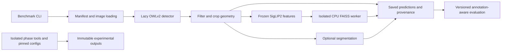

# Phase 10E.12 — full codebase audit and safe refactoring

Parent: `5818ab333dfd239d581129e02af93238bc85e191`, after completed and pushed
Phase10E.11. Branch: `experiment/phase10e12-codebase-audit`. Existing virtual
environment only. No downloads, environment changes, GPU/model forwards, training,
production deployment, source-data edits, checkpoint edits or Mac-project access.

## Outcome

Confirmed and fixed one manifest-to-file checksum binding bug. Consolidated the
active box-intersection expression into a shared helper and reused the existing
EXIF-corrected RGB loader for dataset fingerprints. Changes to existing code are
limited to **five active library modules:27insertions,26deletions**. Historical
phase tools, embedded experiment scripts, trained weights, annotations, predictions,
configs, score thresholds and metric definitions remain unchanged.

For normal valid inputs, measured outputs are exactly equivalent. The intentional
behavior difference is that malformed manifests can no longer validate one file
while returning another, and stale supplied `resolved_file` values no longer
control verification of the actual `file` selected by the manifest.

## Repository architecture and coverage

| Layer | Inventory and role |
|---|---|
| `src/furniture_bench` |26modules; lazy OWLv2 detection, prompts/filtering/crops, SigLIP2embeddings, isolated CPU FAISS retrieval, saved-prediction evaluation, provenance and dataset utilities |
| Other `src` packages |72modules for room geometry/layout/multiview/viewer, optional photo simulation and inpainting; inspected but not modified |
| `tools` |622Python modules /45,349lines across versioned acquisition, auditing, training, loss, cache, review and comparison phases |
| `scripts` |63Python modules /10,690lines plus supporting shell/Swift utilities; workflows, reports and local verification; unchanged |
| `data` |23,713regular files, including33archived Python modules /5,397lines; ABO/Open Images/COCO/LVIS metadata, licences, images, features, splits, experiments and snapshots |
| `models` |44files across original OWLv2, SigLIP2and optional evaluation/simulator model directories |
| Checkpoints across roots |1,021checkpoint-format paths,18,852,138,893logical bytes; includes progress snapshots and aliases, not1,021independent trained models |
| Root test directories |23main test modules,5photo-simulator tests and1inpainting test before the new regression module |
| Historical reports |4,416regular files; recorded predictions, comparisons, charts, seals and provenance |
| Root configs and archives |`pyproject.toml`, requirements sets, README/licence and3small transfer archives inventoried separately |

The baseline automated inventory covered29,081regular files and24,346unique
file identities in the protected roots. Hardlinks explain some differences
between logical size and physical allocation. Python coverage: **845modules,
84,333lines,5,091functions;0ASTsyntax errors**. Entire first-party Python files
were parsed; correctness review was concentrated on active model/data/evaluation
boundaries and selected high-risk historical training/acquisition paths. This is
not a claim that every85kline was manually audited or every phase was executed.

`.git` internals, installed third-party `.venv` sources, caches/runtime trees,
`.local-simulations`, automatic bytecode and Apple resource-fork sidecars were not
traversed as first-party application code. No external Mac application was read
or modified. Detailed path/size/hash inventories and AST indexes stay in the
local ignored `private/` directory; public reports contain aggregates and code
references. A code-only Git clone still does not include the datasets/checkpoints
needed by many historical tools.

These are reusable/default inference paths in the Windows workspace, not evidence
that a production service was deployed. Original pretrained OWLv2 remains the
default. Experimental heads/classifiers are separate. Semantic segmentation,
relative depth, metric geometry and product identity have distinct contracts.

## Confirmed correctness fix

`src/furniture_bench/data.py:load_manifest` formerly verified `image_sha256`
against a supplied `row['resolved_file']` when present, then replaced that path
with the resolution of `row['file']` before returning. A synthetic CPU reproducer
successfully validated decoy-file bytes while returning a different file.

The fix computes the effective path once and uses it for both checksum validation
and the returned `resolved_file`. Existing absolute/relative file semantics are
preserved; no new dataset-root restriction or category policy is introduced.
Tests cover decoy substitution, stale resolved paths, missing actual files,
consistent caches, symlinks, relative/absolute equivalence and unchanged input
bytes. No evidence was found that historical experiments exploited this bug;
existing valid inputs and previous outputs were not rewritten.

## Refactoring changes

1. `geometry.intersection_area(a,b)` now owns the active scalar xyxy intersection
   calculation. IoU, containment and ignored-region coverage use it while retaining
   their own denominators, validation and comparisons. NMS remains strict `>`,
   ignore coverage remains `>=0.5`, and class-aware/tie ordering stays unchanged.
   Pixel, normalized and model-square coordinates are not silently converted.
2. `dataset_quality.fingerprint` now calls the existing `data.load_image`, reusing
   the same EXIF transpose then RGB conversion. Crop rules, resize defaults,
   fingerprint arrays and SHA256ofsource bytes remain identical.
3. Added12focused regression tests, whole-corpus inventory/static analysis,
   offline test/equivalence tooling and preservation verification. Audit output
   writers refuse existing records before overwriting logs. No legacy script was
   deleted, reformatted, reparameterized or redirected to a new utility.

## Duplicated, complex and potentially unnecessary code

The AST scan found **95exact function-body/argument duplicate groups**, with
examples in Phase5B/5Cmetrics/loss/baseline workers, Phase7/8rights methods,
calibration-worker evaluation methods and archived executed-source snapshots.
They are deliberately retained: identical bodies may bind different imported
constants, taxonomy/coverage rules, output roots or authorization budgets.
Historical metric implementations and their numerical/stability variants must
not be replaced merely because their source looks similar.

The active intersection calculation dropped from3implementations to1. The
fingerprint path now shares one EXIF/RGB implementation. No wholesale-function
exact AST duplicates were found inside the active benchmark package.

There are252`sys.path.insert` calls across the inspected corpus and repeated
basenames such as `common`, `report`, `verify` and `acquire`. This creates real
cross-phase import-collision risk, already encountered in historical integrity
work. New tools should use package-qualified imports; don't migrate sealed old
workers in place. Global test discovery across all phase directories is unsafe
because of those import names, lifecycle assertions and writable fixture roots.

Some dense analysis runners have decision-proxy counts around100–121; several
viewer action handlers and report scripts are also large. They were documented
rather than split without suitable behavior fixtures. A simple statement-block
scan found0guaranteed unreachable blocks after unconditional termination. Dynamic
entry points, optional backends, disabled authorization gates and archived copies
are not proven dead code. Nothing was deleted on that assumption.

Two broad-exception/pass flags in historical C18/C20workers were inspected. They
wrap last-resort failure-report persistence; the original training exception is
then re-raised. They were not misreported as swallowed training failures and were
not altered. Future telemetry should retain a fallback diagnostic when persistence
itself fails, without suppressing the original exception.

## Remaining correctness and operational debt, prioritized

**High, before the next real dataset/training cycle**

- **Annotation completeness and protocol interoperability:** the generic benchmark
  evaluator accepts supplied object lists and optionally human evidence; it does
  not carry the same per-category federated negative-coverage semantics as the
  later native-source experimental evaluators. Historical AP/precision values from
  different scopes cannot be merged or compared as one protocol. Build a separately
  versioned annotation-completeness adapter before new mixed-source experiments;
  never treat unannotated regions or categories as verified negatives.
- **Weak cache provenance in the generic catalogue API:**
  `CatalogIndex.assert_compatible` compares IDs/revisions/feature/preprocessing
  metadata, with resolved revisions checked only when both are present. It does
  not independently hash local encoder/preprocessor files. Phase-specific feature
  pipelines already use stronger fingerprints. Future cache schemas should bind
  exact encoder and processor hashes; do not silently invalidate or rewrite old
  caches in this phase.
- **Generic downloader redirect boundary:** `catalog_expansion.DownloadStore`
  validates the initial host, uses `urllib.request.urlopen` by default, then checks
  `response.geturl`. Default redirect following can occur before that check. It is
  not equivalent to recent exact-URL, no-redirect, TLS-metered phase clients and
  should not be used for a new constrained acquisition without a dedicated policy
  change and offline transport tests. This audit issued0network requests.
- **Reproducible environment declaration:** installed Pillow13.0.0exceeds the
  project `<13` bound. Optional OpenCV/PyPDF2and lint tooling are absent here.
  Broad compatible version ranges are not an exact replay lock. Record/approve a
  tested environment specification separately; no packages or bounds changed here.

**Medium, before wider operational use**

- `data.write_json` writes directly to destination, and the generic pipeline rewrites
  the growing prediction document after each image. A crash can truncate a file,
  and repeated whole-history writes grow with run size. Several phase tools solve
  this differently with immutable records. Introduce a tested future atomic/event
  API with explicit overwrite, durability and recovery rules; don't change old
  serialization semantics or sealed outputs as a cleanup side effect.
- `catalog_expansion.atomic_json` and incremental features use fixed temporary
  names. The store declares single-writer semantics; concurrent use would need
  locking/unique temporaries. Do not advertise multiwriter recovery today.
- The persistent FAISS worker waits on `Future.result()` and shutdown without an
  operation deadline. Native isolation avoids OpenMP coupling but does not bound a
  hung native operation. Add a separately tested timeout/restart policy that cannot
  silently substitute index state.
- EXIF-oriented pixels, original native annotations, normalized xyxy and padded
  model-square cxcywh are intentionally different frames. The default detector's
  `(height,width)` postprocessing and training `to_square/from_square` transforms
  were inspected. No current round-trip failure was established; do not unify them
  into one helper without explicit frame contracts and transform fixtures.
- Eleven viewer/integration tests require absent catalogue/preset/prompt fixtures;
 32other tests depend on absent optional packages. Separate self-contained unit
  tests from artifact-backed integration checks rather than weaken checks or
  fabricate fixtures. The missing assets are listed below.
-33archived Python files live under ignored data alongside experiments. Preserve
  their source snapshots and exact hashes separately; a Git code backup alone is
  not a verified backup of those experiments or their weights.

**Lower priority**

- Package-qualified namespaces for new phase tooling; prospective shared hashing,
  atomic IO and budget helpers with explicit policy inputs.
- Smaller analysis functions and explicit configuration structures in future
  versions, preserving frozen runners and metric definitions.
- Profile actual saved-candidate workloads before optimizing NMS, allocation or
  caching. Do not infer model latency from test or scalar-kernel timings.

## Tests and exact behavior comparison

| Check | Result |
|---|---|
| Selected existing CPU suite before change |101passed |
| Same selected CPU suite after change |101passed, identical membership |
| New focused regressions |12passed |
| Broader main test-directory suite |336passed,32skipped,11errors from missing fixtures |
| Real tiny-transformer forward tests |2explicitly excluded; no model forwards authorized |
| Geometry/ignore differential cases |25,000exact float-hex/boolean matches |
| Saved prediction filtering/NMS |9exact outputs from3existing authorized room captures |
| Synthetic matching policies |3exact matching-output hashes |
| EXIF/colour-mode fingerprints |12exact SHA/array fingerprints, including orientations1–8 |
| Historical preservation and E11/E10/E9seals |PASS |

The11missing-fixture errors were reproduced using the parent commit's original
five modules loaded from Git into memory, without changing checkout/files. Same
error types and missing paths;0new broad-suite regressions established:

- `examples/furniture-prompts-v2.json`
- `data/catalogs/abo-phase6d/catalog.json`
- `reports/phase5-public-room/quick-room.json`

The32skips are recorded with actual test IDs/reasons, not silently omitted. The
broader suite remains non-green. No installations or fixture downloads attempted.
The initial audit-harness setup also required correction: subprocess PYTHONPATH,
file-based main for spawn and pre-run capture of test IDs before some test fixtures
shadow `TestCase.id`. Logs are retained; corrected results are authoritative.
One new test assertion was corrected to compare effective path/hash while preserving
the original `file` text. This was a test expectation error, not a production fix.

No official holdout was scored. Saved real-room predictions were only refiltered;
ground-truth matching checks used synthetic fixtures. Model calls in selected
adapter tests used mocks, and actual trained-model forward tests were excluded.
No new training labels were created; all synthetic inputs remained temporary.

## Size, complexity and measured efficiency

| Scoped measure | Before | After |
|---|---:|---:|
| Modified active module lines |819 |820 |
| Modified active module bytes |33,859 |33,796 |
| Functions in modified modules |34 |35 |
| Decision-proxy sum in modified modules |277 |277 |
| Active intersection implementations |3 |1 |
| Original corpus plus regression tests: modules |845 |846 |
| Original corpus plus regression tests: lines |84,333 |84,453 |

The decision proxy is a documented AST approximation, not an external-tool McCabe
claim. It counts branch/loop/exception/boolean/comprehension decisions and excludes
nested function bodies. Shared logic improved consistency without a false claim
that overall complexity or line count dramatically fell. Five new audit utilities
add271lines, making the final inspected Python corpus **851modules /84,724lines**
including those utilities. Historical duplicates remain for reproducibility.

A bounded CPU microbenchmark compared the parent IoU function with the refactored
one:8alternating rounds/version,80,000calls/round, identical accumulated float hex.
Median times were18.226msbefore and19.297msafter: about**5.9%slower** for this
isolated scalar kernel, consistent with an extra function call. This trade-off is
reported openly and retained for shared semantics/maintainability; no detector,
training, memory or end-to-end speedup is claimed. No new inference was run to
profile model latency or VRAM. Test-suite warm/cold durations are not performance
comparisons.

## Integrity, reproducibility and review

Before/after SHA256inventories show **29,076unchanged original files**, exactly
5intentional active-module changes and1new regression test. No files removed.
All **28,173existing data/model/historical-report files are byte-identical**, as
are every historical tool/script. The independent historical checker also passed
its9,973data/model record set and all applicable experiment seals. Main remains
`e14c4c253d4680e7d3c2a87d0d896c6d20e86aa6`.

Historical source versions remain available in the immutable parent commit and
existing executed-source snapshots. Local datasets, checkpoints, annotations and
recorded predictions retain their fingerprints. This preserves existing replay
inputs; **GPU experiment reproduction was not executed** and no claim is made
that a clean install from broad requirements alone is an exact historical replay.
The environment/fixture gaps above remain real limitations.

Detailed local indexes:
`reports/phase10e12-v1/private/protected-before.json`, `protected-after.json`,
`checkpoint-inventory.json` and AST indexes. They are excluded from Git. Public
summary/seal files contain their hashes and aggregate counts. No photos, model
weights, private dataset bodies or permission records are pushed.

Review the small library diff and synthetic regressions independently of the
inventory/report tooling. To return to the previous implementation after this
branch is clean, switch to `experiment/phase10e11-wellcome-suitability`; do not
reset/delete history or restore models. Any future application rollout remains a
separate decision. No production model, threshold, evaluation definition or Mac
application was replaced by this audit.
